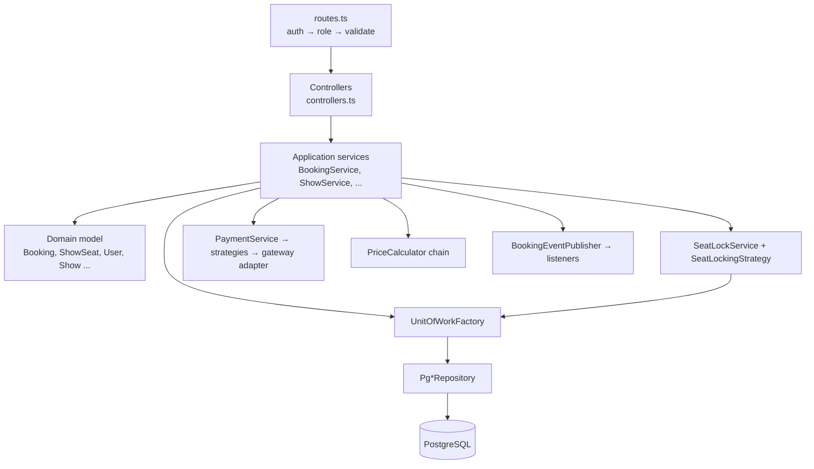

# Architecture — BookMySeat

## 1. System context

```
┌──────────────┐  HTTPS/JSON   ┌──────────────────────────┐  SQL (pg)   ┌──────────────┐
│  Browser     │ ────────────▶ │  Express REST API        │ ──────────▶ │ PostgreSQL   │
│  React SPA   │ ◀──────────── │  (stateless, Node 22)    │ ◀────────── │ single source│
│  (Vite)      │   /api/*      │                          │             │ of truth     │
└──────────────┘               │  ┌────────────────────┐  │             └──────────────┘
                               │  │ HoldExpiryJob      │  │
                               │  │ (setInterval)      │  │  callback   ┌──────────────┐
                               │  └────────────────────┘  │ ──────────▶ │ LegacyPaySdk │
                               └──────────────────────────┘  (adapter)  │ (simulated)  │
                                                                        └──────────────┘
```

- **Frontend** ([frontend/src](../frontend/src)) renders state returned by the API and never decides availability or price.
- **Backend** ([backend/src](../backend/src)) is stateless: no in-memory locks or sessions are used for correctness. Every invariant is enforced inside PostgreSQL transactions and constraints.
- **PostgreSQL** holds all state, including the row locks and advisory locks that serialise competing bookings.

## 2. Layered backend architecture



| Layer | Responsibility | May depend on | Must NOT |
|---|---|---|---|
| Routes / middleware ([routes.ts](../backend/src/http/routes.ts), [middleware/index.ts](../backend/src/http/middleware/index.ts)) | URL map, authentication, role check, zod validation, error envelope | controllers, services (AuthService for auth) | contain business rules |
| Controllers ([controllers.ts](../backend/src/http/controllers/controllers.ts), [presenters.ts](../backend/src/http/controllers/presenters.ts)) | Translate HTTP ⇄ service calls, map entities to DTOs, choose status code | services | touch SQL, open transactions |
| Application services ([services/](../backend/src/services)) | Use-case orchestration, **transaction boundaries**, authorisation of resources, event publication after commit | domain, repository *interfaces*, other services/strategies via interfaces | import `pg` or Express |
| Domain ([domain/](../backend/src/domain)) | Entities, state machines, invariants, builder | `common/errors` only | know about persistence or HTTP |
| Persistence ports ([repositories/interfaces.ts](../backend/src/repositories/interfaces.ts)) | Abstract repository contracts, `UnitOfWork`, `UnitOfWorkFactory` | domain types | — |
| Persistence adapters ([repositories/pg/](../backend/src/repositories/pg)) | SQL, row ↔ entity mapping, locking clauses | `Queryable`, domain | contain business decisions |
| Infrastructure ([db/](../backend/src/db)) | Pool singleton, transaction manager, migrations, seed | `pg`, config | — |

Dependency direction always points **inwards** (towards the domain and the interfaces); the only place that knows concrete classes is the composition root.

## 3. Module map

### Backend (`backend/src`)

| Path | Contents |
|---|---|
| [config/env.ts](../backend/src/config/env.ts) | zod-validated, typed configuration (fails fast on bad env) |
| [common/](../backend/src/common) | `errors.ts` (AppError hierarchy), `Clock.ts` (SystemClock, FixedClock), `logger.ts` (JSON logs), `money.ts` |
| [domain/](../backend/src/domain) | `Entity`, `User`/`Customer`/`Admin`/`UserFactory`, `Movie`, `Theatre`, `Screen`, `Seat`, `Show`, `ShowSeat`, `Booking`/`BookingBuilder`, `Payment`, `enums`, `events` |
| [concurrency/SeatLockingStrategy.ts](../backend/src/concurrency/SeatLockingStrategy.ts) | `SeatLockingStrategy`, `AbstractSeatLockingStrategy`, `PessimisticSeatLockingStrategy`, `OptimisticSeatLockingStrategy`, `createSeatLockingStrategy` |
| [services/](../backend/src/services) | `AuthService` (+ `BcryptPasswordHasher`, `JwtTokenService`), `MovieService`, `TheatreService`, `SeatLayoutFactory`, `ShowService`, `SeatAvailabilityService`, `SeatLockService`, `BookingService`, `HoldExpiryJob`, `AdminService` |
| [pricing/pricing.ts](../backend/src/pricing/pricing.ts) | pricing strategies, calculator, decorators, factory |
| [payments/](../backend/src/payments) | `PaymentStrategies.ts`, `PaymentStrategyFactory.ts`, `PaymentService.ts`, `gateway/` (port, simulated SDK, adapter) |
| [notifications/](../backend/src/notifications) | `BookingEventPublisher` (subject), `NotificationService`, `AuditLogListener`, channels |
| [repositories/](../backend/src/repositories) | interfaces, read models, `pg/` implementations, `PgUnitOfWork.ts` |
| [db/](../backend/src/db) | `Database.ts`, `TransactionManager.ts`, `migrate.ts`, `seed.ts`, `migrations/*.sql` |
| [http/](../backend/src/http) | `routes.ts`, `controllers/`, `middleware/`, `validators/schemas.ts` |
| [container.ts](../backend/src/container.ts) | composition root (manual DI) |
| [app.ts](../backend/src/app.ts) / [server.ts](../backend/src/server.ts) | Express app factory / process entry point |

### Frontend (`frontend/src`)

| Path | Contents |
|---|---|
| [api/](../frontend/src/api) | `types.ts` (DTOs), `httpClient.ts` (`HttpClient`, `ApiError`), `endpoints.ts` (typed `api` facade, idempotency keys) |
| [state/](../frontend/src/state) | `AuthContext.tsx` (global auth state), `hooks.ts` (`useObservable`, `useAsync`, `useCountdown`) |
| [patterns/](../frontend/src/patterns) | `Observable`, `SeatAvailabilityPoller`, `seatSelectionStrategies`, `paymentForms` |
| [components/](../frontend/src/components) | `common.tsx` (Layout, RequireAuth, Alert, Poster, PriceBreakdown, …), `SeatMap.tsx` |
| [pages/](../frontend/src/pages) | `AuthPage`, `MoviesPage`, `MovieDetailsPage`, `SeatSelectionPage`, `CheckoutPage`, `BookingPages` (confirmation, history), `AdminDashboardPage` |
| [App.tsx](../frontend/src/App.tsx) | routes and guards |

## 4. Request lifecycle (example: `POST /api/bookings`)

1. **Express** parses JSON (limit 100 kB) and initialises `req.valid` ([app.ts](../backend/src/app.ts)).
2. **`authenticate`** reads the bearer token, `AuthService.authenticate` verifies the JWT and loads a live `User` subclass.
3. **`validate('body', HoldBody)`** parses and coerces input; failures throw `ZodError`.
4. **`BookingController.createHold`** reads the optional `Idempotency-Key` and calls `BookingService.createHold`.
5. **`BookingService`** checks input rules, opens a transaction via `UnitOfWorkFactory.transaction`, takes an advisory lock for the key, loads the show, prices seats (`PriceCalculator`), builds a `BookingDraft` (`BookingBuilder`) and delegates locking to `SeatLockService.hold`.
6. **`SeatLockService`** uses the configured `SeatLockingStrategy` to lock/validate the `show_seats` rows, re-claims expired holds, inserts the booking header, claims the seats and inserts line items.
7. **`TransactionManager`** COMMITs; on any exception it ROLLBACKs and, for `40001`/`40P01`, retries.
8. Constraint errors are mapped to domain errors (`withConstraintMapping`), the summary read model is loaded and decorated (`cancellable`, `holdSecondsRemaining`).
9. **`ok()`** writes `{ success: true, data }` with 201 (or 200 for an idempotent replay). Any thrown error reaches **`errorHandler`**.

## 5. Composition root and dependency injection

[container.ts](../backend/src/container.ts) builds the whole object graph with constructor injection — no DI framework, no service locator:

```ts
const uowFactory: UnitOfWorkFactory = overrides.wrapUnitOfWork ? overrides.wrapUnitOfWork(baseUow) : baseUow;
const gateway = overrides.paymentGateway ?? new LegacyPayGatewayAdapter(new LegacyPaySdk(...));
const seatLockService = new SeatLockService(createSeatLockingStrategy(overrides.seatLockStrategy ?? cfg.SEAT_LOCK_STRATEGY));
const bookingService = new BookingService(uowFactory, seatLockService, paymentService, calculator, events, clock, policy);
```

`ContainerOverrides` (`config`, `pool`, `clock`, `paymentGateway`, `seatLockStrategy`, `wrapUnitOfWork`) is how tests substitute a `FixedClock`, a fake gateway, either locking strategy, or a fault-injecting Unit-of-Work decorator — without touching production code. `createApp(container)` is side-effect free, so integration tests start real servers on ephemeral ports ([tests/helpers/testApp.ts](../backend/tests/helpers/testApp.ts)).

## 6. Unit of Work and transaction management

- [`Database`](../backend/src/db/Database.ts) — Singleton owning the one `pg.Pool` per process.
- [`TransactionManager.run(work, { isolation, retries })`](../backend/src/db/TransactionManager.ts) — checks out a client, `BEGIN ISOLATION LEVEL …`, runs `work`, `COMMIT`; on throw `ROLLBACK`; retries up to 3 times with jitter on serialization failure / deadlock.
- [`PgUnitOfWorkFactory`](../backend/src/repositories/pg/PgUnitOfWork.ts) — `db` exposes repositories on the pool (autocommit reads); `transaction(fn)` gives `fn` a `UnitOfWork` whose repositories **all share the same transactional client**. Services therefore compose several repository calls atomically without ever writing `BEGIN`/`COMMIT`.
- **Transaction boundary rule:** one use case = one transaction, owned by the application service (`BookingService`, `TheatreService.addScreen`, `ShowService.create`, `HoldExpiryJob` per booking). `SeatLockService` never opens a transaction; it always runs inside the caller's.
- **Side effects after commit:** `BookingService` returns an outcome from the transaction and publishes domain events only after it committed, so users are never notified about rolled-back work.

## 7. Error handling pipeline

```
throw AppError subclass (domain/service)  ─┐
throw ZodError (validation middleware)     ├─▶ errorHandler ─▶ { success:false, error:{ code, message, details? } }
pg error with SQLSTATE (constraint)        │      + HTTP status
anything else                              ─┘      (5xx logged with stack, generic message returned)
```

- [`AppError`](../backend/src/common/errors.ts) subclasses carry `statusCode` and `code` (polymorphism): `ValidationError` 400, `UnauthorizedError` 401, `ForbiddenError` 403, `NotFoundError` 404, `ConflictError` 409 → `SeatUnavailableError` 409, `HoldExpiredError` 410, `BusinessRuleError` 422, `PaymentFailedError` 402.
- `PG_ERRORS` maps `23505`, `23503`, `23P01` (`SHOW_OVERLAP`), `23514`, `22P02`, `40001`, `40P01` to stable codes.
- Body-parser JSON errors → 400 `MALFORMED_JSON`; unknown routes → 404 `ROUTE_NOT_FOUND`.
- The frontend's `HttpClient` converts every non-OK response and every network failure (status 0, `NETWORK_ERROR`) into one `ApiError` type with helpers `isConflict`, `isUnauthorized`, `isNetwork`.

## 8. Frontend architecture

| Concern | Implementation |
|---|---|
| Routing & guards | `react-router-dom` routes in [App.tsx](../frontend/src/App.tsx); `RequireAuth` (optionally `admin`) redirects anonymous users to `/login` with a return path |
| Global state | `AuthContext` (user, ready, login/register/logout); only the JWT is persisted (`localStorage`, wrapped in try/catch) |
| Server state | page-local via `useAsync`; seat availability via the `SeatAvailabilityPoller` subject + `useObservable` hook |
| API communication | single `HttpClient` + typed `api` facade; components never build URLs |
| Behaviour variation | `SeatSelectionStrategy` (manual / contiguous block), `PaymentFormStrategy` via `PaymentFormFactory` |
| Presentation | reusable components (`SeatMap`, `SeatLegend`, `PriceBreakdown`, `Countdown`, `StatusBadge`, `Alert`, `Poster`) and one stylesheet with CSS variables |
| Error UX | conflicts (409/410) trigger a seat-map refresh; payment network errors keep the idempotency key so retries are safe; 401 anywhere signs the user out |

Booking flow: `MoviesPage` → `MovieDetailsPage` (shows grouped by day/city/theatre) → `SeatSelectionPage` (hold) → `CheckoutPage` (summary, countdown, payment) → `ConfirmationPage` → `BookingHistoryPage` (cancel, notifications).

### Frontend–backend separation
The SPA calls relative `/api/...` URLs. In development the Vite dev server proxies `/api` to `http://localhost:4000` ([vite.config.ts](../frontend/vite.config.ts)), so the browser sees a single origin. For a split deployment `VITE_API_URL` points the client elsewhere and the backend's `CORS_ORIGIN` allows that origin. The contract between the two is the JSON envelope documented in [API_DOCUMENTATION.md](API_DOCUMENTATION.md) and typed in [frontend/src/api/types.ts](../frontend/src/api/types.ts).

## 9. Cross-cutting concerns

| Concern | Where |
|---|---|
| Validation | zod schemas at the boundary ([schemas.ts](../backend/src/http/validators/schemas.ts)); business rules in services/domain; DB constraints as last line |
| Authentication | JWT (`JwtTokenService`), `authenticate` / `optionalAuthenticate` middleware |
| Authorisation | role: `requireCatalogManager` uses polymorphic `User.canManageCatalog()`; resource: `User.canAccessBookingOf(ownerId)` in `BookingService` |
| Logging | structured JSON via [logger.ts](../backend/src/common/logger.ts), level from `LOG_LEVEL`; 5xx logged with stack |
| Configuration | [env.ts](../backend/src/config/env.ts): typed, defaulted, validated once at start-up |
| Time | injected `Clock` everywhere a decision depends on "now" |
| Idempotency | `Idempotency-Key` header parsed by `idempotencyKey(req)`; enforced in `BookingService` |

## 10. Extensibility points

| Change | What to add | What does NOT change |
|---|---|---|
| New payment method (e.g. NetBanking) | a `BasePaymentStrategy` subclass + `register()` in `PaymentStrategyFactory.withDefaults`; enum value; a `PaymentFormStrategy` on the frontend | `PaymentService`, `BookingService`, controllers |
| New payment provider | a class implementing `PaymentGateway` (or another adapter) wired in `container.ts` | strategies, services |
| New pricing rule (discount, festival fee) | a `PriceCalculatorDecorator` subclass and one line in `PriceCalculatorFactory.create` | `BookingService`, existing decorators |
| New seat pricing scheme | a `SeatPricingStrategy` | calculator chain, seat map |
| New locking mechanism (e.g. SERIALIZABLE, Redis) | a `SeatLockingStrategy` implementation + factory case | `SeatLockService`, `BookingService` |
| New notification channel (push, WhatsApp) | a `NotificationChannel` passed to `NotificationService` | publisher, booking flow |
| New reaction to bookings (analytics, loyalty points) | a `BookingEventListener` subscribed in `container.ts` | `BookingService` |
| New seat layout preset | entry in `SeatLayoutFactory.PRESETS` | screen API |

## 11. Deployment and scalability

**Current design properties**
- The API process holds no correctness-relevant state, so N instances can run behind a load balancer: competing requests on different instances still meet at the same PostgreSQL rows, row locks and advisory locks.
- `HoldExpiryJob` is safe to run on every instance concurrently: it re-checks each booking under row locks and the orphan sweep re-evaluates rows after locking (verified by the "safe to run concurrently" test).
- Transactions are short (milliseconds); the simulated gateway call happens inside the pay transaction (see trade-off in [CONCURRENCY_DESIGN.md](CONCURRENCY_DESIGN.md)).
- Pool size (`DB_POOL_MAX`) bounds DB connections per instance.

**Future work (not implemented)**
- Move the external gateway call outside the row-lock window (two-phase pay with a `PROCESSING` state) when a real, slow gateway is integrated.
- Read replicas for catalogue and seat-map reads; keep all writes on the primary.
- Cache movie/show listings (e.g. Redis) with short TTL; seat maps could use Server-Sent Events / WebSockets instead of 5 s polling.
- Leader election (or `pg_try_advisory_lock`) so only one instance runs the sweeper.
- Outbox table for notifications to guarantee at-least-once delivery after commit.
- Partition `show_seats`/`bookings` by show date once data volume demands it.
