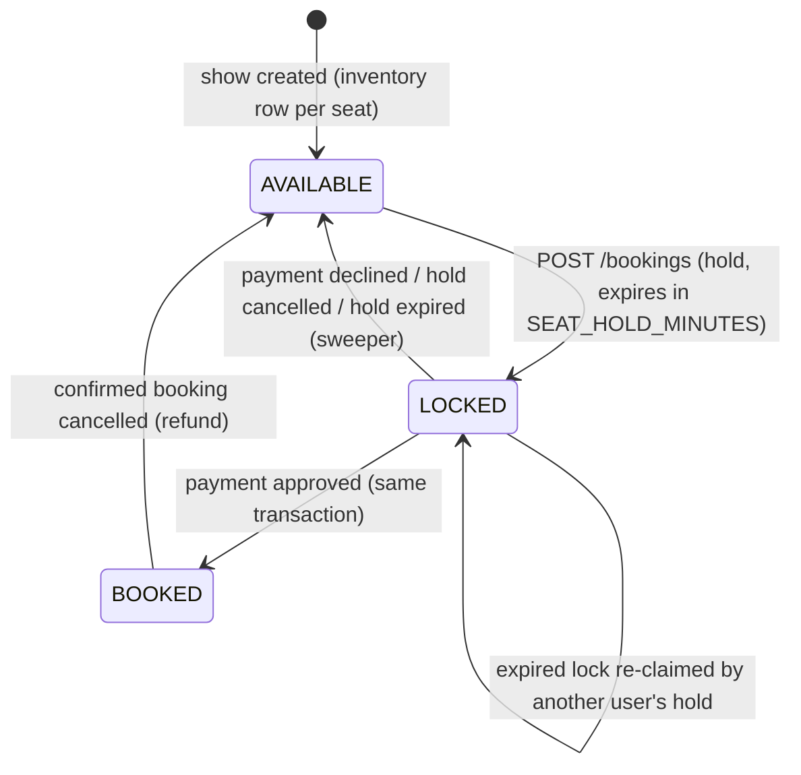

# Concurrency Design: Guaranteeing "One Seat, One Booking"

This document explains how BookMySeat makes double booking impossible, even when many users click **Book** on the same seat at the same instant. It covers the problem, the seat lifecycle, the nine defence layers, step-by-step timelines for every race we identified, the trade-offs, and the tests that prove each claim.

Key code:

| Concern | File |
|---|---|
| Locking strategies (pessimistic / optimistic) | [`backend/src/concurrency/SeatLockingStrategy.ts`](../backend/src/concurrency/SeatLockingStrategy.ts) |
| Seat lifecycle orchestration, reclaim, lock order | [`backend/src/services/SeatLockService.ts`](../backend/src/services/SeatLockService.ts) |
| Transaction boundaries, idempotency, payment | [`backend/src/services/BookingService.ts`](../backend/src/services/BookingService.ts) |
| SQL: `FOR UPDATE`, compare-and-set, release | [`backend/src/repositories/pg/PgShowSeatRepository.ts`](../backend/src/repositories/pg/PgShowSeatRepository.ts) |
| BEGIN/COMMIT/ROLLBACK + retry | [`backend/src/db/TransactionManager.ts`](../backend/src/db/TransactionManager.ts) |
| Expiry sweeper | [`backend/src/services/HoldExpiryJob.ts`](../backend/src/services/HoldExpiryJob.ts) |
| Constraints | [`backend/src/db/migrations/001_initial_schema.sql`](../backend/src/db/migrations/001_initial_schema.sql) |
| Proof | [`backend/tests/concurrency/booking-concurrency.test.ts`](../backend/tests/concurrency/booking-concurrency.test.ts), [`backend/tests/integration/bookings.test.ts`](../backend/tests/integration/bookings.test.ts) |

---

## 1. The problem: check-then-act

The naive implementation does two separate steps:

```
1. SELECT status FROM show_seats WHERE id = A1     -- "is it free?"
2. UPDATE show_seats SET status = 'BOOKED' ...      -- "then take it"
```

Between step 1 and step 2, another request can run its own step 1 and also see `AVAILABLE`. Both then run step 2, and both users have paid for seat A1. This is a classic **race condition (lost update)**. It cannot be fixed in the browser: two browsers have no shared memory, and a malicious client can call the API directly.

**Rule: the frontend is never the source of truth.** The seat map shown to users is a hint, refreshed every 5 s. Every booking request is re-validated by the backend inside a database transaction that holds or verifies the relevant rows, and the database itself enforces the final invariant.

---

## 2. Seat lifecycle



Booking lifecycle in parallel (`Booking` aggregate, [`Booking.ts`](../backend/src/domain/Booking.ts)):

```
PENDING --confirm()-----------> CONFIRMED --cancel() (before cut-off)--> CANCELLED
   |--markPaymentFailed()-----> FAILED
   |--expire()----------------> EXPIRED
   |--cancel()----------------> CANCELLED (hold abandoned, no refund)
```

Both state machines are encoded **twice**:

1. In domain classes (`ShowSeat.lock/book/release`, `Booking.confirm/expire/cancel`), which throw on illegal transitions.
2. In the database (`ck_show_seats_state` CHECK and the partial unique indexes), which rejects inconsistent rows.

An expired lock (`status = 'LOCKED' AND lock_expires_at <= now`) is treated as available everywhere: `ShowSeat.isAvailableAt`, `effectiveStatus`, the listing counts in `PgShowRepository`, and the reclaim logic. Correctness therefore never depends on the sweeper running on time.

---

## 3. Defence in depth: the nine layers

### Layer 1: Pessimistic row-level locking (`SELECT … FOR UPDATE`)

`PessimisticSeatLockingStrategy` (the default, `SEAT_LOCK_STRATEGY=PESSIMISTIC`) loads the requested seats with:

```sql
SELECT ss.*, se.row_label, se.seat_number, se.category
FROM show_seats ss JOIN seats se ON se.id = ss.seat_id
WHERE ss.show_id = $1 AND ss.seat_id = ANY($2::bigint[])
ORDER BY ss.id
FOR UPDATE OF ss
```

- `FOR UPDATE OF ss` takes an **exclusive row lock** on the `show_seats` rows only, not the joined `seats` rows, until COMMIT or ROLLBACK.
- A second transaction that wants the same row **blocks** at this statement. When the first commits, PostgreSQL hands the second the newest committed version of the row. It sees `LOCKED`, and `AbstractSeatLockingStrategy.reserveCandidates` throws `SeatUnavailableError` (409).
- `ORDER BY ss.id` makes every transaction acquire row locks in the same order (see Layer 8).

### Layer 2: Optimistic locking (version compare-and-set)

`OptimisticSeatLockingStrategy` (`SEAT_LOCK_STRATEGY=OPTIMISTIC`) reads the seats **without** locks and then claims them atomically:

```sql
UPDATE show_seats ss
SET status = 'LOCKED', booking_id = $3, lock_expires_at = $4, version = ss.version + 1, updated_at = now()
FROM unnest($1::bigint[], $2::int[]) AS expected(id, version)
WHERE ss.id = expected.id AND ss.version = expected.version
RETURNING ss.id
```

Every write to `show_seats` increments `version`. If fewer rows are updated than requested, someone changed a seat after we read it, and the strategy throws `SeatUnavailableError`. The transaction then rolls back, including the booking header it inserted.

Under READ COMMITTED, a concurrent `UPDATE` of the same row waits for the other writer. Once that writer commits, PostgreSQL **re-evaluates the WHERE clause against the new committed row** (EvalPlanQual). The version no longer matches, so 0 rows are updated. This is why the compare-and-set is race-free without SERIALIZABLE.

Both strategies implement one interface and share validation through the template method in `AbstractSeatLockingStrategy` (Strategy + Template Method; LSP). The **entire concurrency suite runs against both**.

| | Pessimistic | Optimistic |
|---|---|---|
| Losers | wait briefly, then fail with a clear 409 | fail at claim time (409) |
| Best when | high contention (a hot seat, premieres) | low contention |
| Cost | locks held for the transaction's duration | wasted work on conflict |

### Layer 3: Partial unique index, the database's final word

```sql
CREATE UNIQUE INDEX ux_booking_seats_one_active_per_show_seat
    ON booking_seats (show_seat_id) WHERE is_active;
```

A show seat can appear in **at most one active** booking line. Even if a future code path forgot the lock, the second `INSERT INTO booking_seats` would fail with `23505`. `BookingService.withConstraintMapping` turns that into `409 SEAT_UNAVAILABLE`, and the transaction rolls back. Under the optimistic strategy, this index also serialises concurrent inserts: the second inserter waits on the first's uncommitted index entry, then fails.

Similarly, `ux_payments_one_success_per_booking` (`UNIQUE (booking_id) WHERE status IN ('SUCCESS','REFUNDED')`) makes it impossible to capture money twice for one booking.

### Layer 4: CHECK constraint on the seat state

```sql
CONSTRAINT ck_show_seats_state CHECK (
  (status = 'AVAILABLE' AND booking_id IS NULL     AND lock_expires_at IS NULL) OR
  (status = 'LOCKED'    AND booking_id IS NOT NULL AND lock_expires_at IS NOT NULL) OR
  (status = 'BOOKED'    AND booking_id IS NOT NULL AND lock_expires_at IS NULL))
```

Rules out half-written states such as "BOOKED by nobody".

### Layer 5: Transactions with rollback and automatic retry

`TransactionManager.run(work)` executes `BEGIN ISOLATION LEVEL READ COMMITTED` → `work(client)` → `COMMIT`. **Any exception means `ROLLBACK`**, so every statement in the unit of work is undone: the booking header, payment row, seat updates and line items. On SQLSTATE `40001` (serialization failure) or `40P01` (deadlock detected), the whole unit of work is retried up to 3 times with jittered back-off. Services never write `BEGIN`/`COMMIT`; they hand a callback to `UnitOfWorkFactory.transaction`, which binds all repositories to the same client.

Business failures that must be **persisted** (a declined payment, an expired hold) are **returned** from the transaction callback as an outcome object (`PayOutcome`) so they COMMIT. The HTTP error (402/410) is thrown only after the commit.

### Layer 6: Idempotency (duplicate requests)

Double-clicks, browser retries and flaky networks produce duplicate requests.

- **Hold:** with `Idempotency-Key: K`, the transaction first takes `pg_advisory_xact_lock(hashtextextended('hold:{userId}:{K}', 0))`. All requests with the same user and key are serialised. The first creates the booking, and every later one finds it via `findByUserAndIdempotencyKey` and returns it with **200**. `UNIQUE (user_id, idempotency_key)` backs this up at the database level. Reusing a key for a different request gives `422 IDEMPOTENCY_KEY_REUSED`.
- **Payment:** the booking row is locked `FOR UPDATE` before anything else. A request with a key that already has a `payments` row (`UNIQUE (booking_id, idempotency_key)`) returns the original outcome without charging again. A second payment **without** a key finds the booking `CONFIRMED` and gets `409`.

### Layer 7: Lock expiry, abandoned holds and cleanup

Holds last `SEAT_HOLD_MINUTES` (default 5). Three mechanisms cooperate:

1. **Lazy reclaim** (`SeatLockService.reclaimExpiredHolds`). When a new hold's candidate seats include an expired lock, in the same transaction it:
   - deactivates the stale booking lines for exactly those seats;
   - locks the stale bookings (`FOR UPDATE`, ascending id) and marks them `EXPIRED` if they are still `PENDING` and expired;
   - lets the new hold claim the seat.
2. **Sweeper** (`HoldExpiryJob`, every `HOLD_EXPIRY_JOB_INTERVAL_MS`, default 30 s). For each `PENDING` booking with `expires_at <= now`, in its own transaction it:
   - locks seats, then the booking;
   - **re-checks under lock** (the user may have just paid);
   - expires the booking, releases its seats, and publishes `BOOKING_EXPIRED`.

   A per-process `running` flag prevents overlapping sweeps. Because of the re-check, two sweepers running concurrently expire each booking exactly once, which is tested.
3. **Orphan sweep** (`releaseOrphanedLocks`). This frees seats still marked `LOCKED`-but-expired whose booking is no longer `PENDING`; these can be left behind after a lazy reclaim that touched only some of an old booking's seats. Each row is re-checked after its row lock is acquired, so a seat concurrently re-claimed with a fresh expiry is skipped.

Time comes from an injected `Clock` (`SystemClock` in production, `FixedClock` in tests), so expiry is tested deterministically without sleeping.

### Layer 8: Global lock ordering (deadlock prevention)

Every write path acquires locks in the same order:

```
1. show_seats rows   (ascending id)      2. bookings rows   (ascending id)
```

| Path | Locks taken |
|---|---|
| Hold (pessimistic) | seats `FOR UPDATE ORDER BY ss.id` → stale bookings `FOR UPDATE ORDER BY id` |
| Pay, cancel, sweeper | `SeatLockService.lockBookingForUpdate`: read the booking's active line ids (no lock) → lock those seats `FOR UPDATE ORDER BY ss.id` → lock the booking `FOR UPDATE` |

With one global order, no cycle of waits can form between these paths. The optimistic claim sorts ids too. A deadlock is still possible in theory, for example through the join order of `UPDATE … FROM unnest` or the reclaim path. PostgreSQL detects it within `deadlock_timeout` and aborts one transaction with `40P01`, which `TransactionManager` retries; any error that remains surfaces as `409 CONCURRENT_UPDATE`. The overlapping-window test (below) never produced a 5xx.

### Layer 9: Side effects only after COMMIT

Notifications (Observer: `BookingEventPublisher` → `NotificationService`, `AuditLogListener`) are published **after** the transaction commits. Users are never e-mailed about a booking that was rolled back. A failing listener is logged and cannot affect the booking or the other listeners.

---

## 4. Timelines

Notation: T1 and T2 are two concurrent transactions (two HTTP requests); time flows downwards.

### 4.1 Same seat, pessimistic strategy

| Step | T1 (Alice) | T2 (Bob) |
|---|---|---|
| 1 | `BEGIN` | `BEGIN` |
| 2 | `SELECT … A1 FOR UPDATE` → row lock acquired, `AVAILABLE` | |
| 3 | | `SELECT … A1 FOR UPDATE` → **blocks** (A1 locked by T1) |
| 4 | insert booking header, `UPDATE A1 → LOCKED(b=101)`, insert line | (waiting) |
| 5 | `COMMIT` → lock released | |
| 6 | | wakes up, reads the committed row: `LOCKED`, not expired |
| 7 | | `reserveCandidates` throws `SeatUnavailableError` → `ROLLBACK` → **409** |

**Why it works:** step 3 cannot complete until T1 has finished, so T2 can never base its decision on the pre-T1 state.

### 4.2 Same seat, optimistic strategy

| Step | T1 | T2 |
|---|---|---|
| 1 | `SELECT A1` (no lock) → `AVAILABLE, version 3` | `SELECT A1` → `AVAILABLE, version 3` |
| 2 | insert header b=101 | insert header b=102 |
| 3 | `UPDATE … WHERE id=A1 AND version=3` → 1 row, version → 4 (row lock held) | |
| 4 | | `UPDATE … WHERE id=A1 AND version=3` → **waits** for T1's row lock |
| 5 | insert line, `COMMIT` | |
| 6 | | PostgreSQL re-evaluates `version = 3` against the committed row (version 4): **false** → 0 rows |
| 7 | | `claim` sees 0 of 1 updated → `SeatUnavailableError` → `ROLLBACK` (header b=102 disappears) → **409** |

**Why it works:** the compare-and-set is atomic per row. Under READ COMMITTED the blocked UPDATE re-checks its predicate on the latest committed version, so a stale read can never win.

### 4.3 Overlapping multi-seat requests

T1 wants `{A1, A2, A3}`, T2 wants `{A3, A2, A1}` (reverse order in the request).

| Step | T1 | T2 |
|---|---|---|
| 1 | `FOR UPDATE … ORDER BY ss.id` → locks A1, A2, A3 in id order | `FOR UPDATE … ORDER BY ss.id` → tries A1 first → **blocks** |
| 2 | claim all three, `COMMIT` | |
| 3 | | acquires A1, A2, A3 → all `LOCKED` → 409 |

Without `ORDER BY`, T2 might lock A3 first while T1 holds A1 and waits for A3. That is a deadlock. Sorting removes the cycle. Partially overlapping windows behave the same way: whoever gets the lowest shared id first wins all shared seats, and the other gets a 409 for the whole request. A booking is **all-or-nothing**; partial holds never happen.

### 4.4 Expired-lock reclaim race

Alice held A1 at 10:00 (expires 10:05) and walked away. At 10:06 the sweeper has not run yet, and Bob and Carol both click A1.

| Step | T-Bob | T-Carol |
|---|---|---|
| 1 | `FOR UPDATE A1` → `LOCKED(b=Alice)`, expires 10:05 ≤ 10:06 → **available** | blocks on A1 |
| 2 | deactivate Alice's line for A1; lock Alice's booking → mark `EXPIRED` | (waiting) |
| 3 | insert Bob's booking; A1 → `LOCKED(b=Bob, exp 10:11)`; insert Bob's line (index allows it: Alice's line is inactive) | |
| 4 | `COMMIT` | |
| 5 | | reads A1 = `LOCKED(b=Bob)`, not expired → **409** |
| 6 | Alice later tries to pay → booking `EXPIRED` → **410 HOLD_EXPIRED** | |

### 4.5 Double payment submit (same booking, 10 concurrent requests)

| Step | P1 | P2…P10 |
|---|---|---|
| 1 | lock seats, then `bookings … FOR UPDATE` | block on the same seat or booking rows |
| 2 | `assertPayable` OK, `assertStillHeld` OK, charge gateway → approved | (waiting) |
| 3 | insert payment SUCCESS, seats → `BOOKED`, booking → `CONFIRMED`, `COMMIT` | |
| 4 | | each wakes, sees `CONFIRMED` → `ConflictError` → **409**; with the same `Idempotency-Key` it gets a **200 replay** instead |

Result: exactly one `payments` row, exactly one charge. If the gateway were somehow called twice, `ux_payments_one_success_per_booking` would reject the second SUCCESS row.

### 4.6 Payment racing hold expiry or reclaim

| Case | What happens |
|---|---|
| Pay arrives after `expires_at` | the pay transaction sees `booking.isHoldExpired(now)` → `expireHold` (booking `EXPIRED`, seats released) → **COMMIT** → `410 HOLD_EXPIRED` |
| Bob reclaimed one of Alice's seats first | Alice's booking is already `EXPIRED`, so `assertPayable` → `410` |
| Seat state does not match the hold (e.g. seat no longer `LOCKED` by this booking) | `assertStillHeld` → `410`; the transaction rolls back **before** the gateway is called |
| Alice's pay holds the locks first | reclaim and sweeper block on the seat rows. Alice can only pay while `expires_at > now`; after commit the seats are `BOOKED`, so the reclaimer sees them as unavailable and the sweeper's re-check (`isHoldExpired` false for `CONFIRMED`) skips them |

The same rule (`lock_expires_at <= now` means expired) is applied by every party with the same clock, so "valid for payment" and "reclaimable" can never both be true.

### 4.7 Gateway outage: rollback

Card `4000000000009999` makes the simulated SDK fail with an error (not a decline). `LegacyPayGatewayAdapter` rejects with `GatewayUnavailableError`:

| Step | Pay transaction |
|---|---|
| 1 | seats and booking locked, checks pass |
| 2 | `payments.charge()` **throws** |
| 3 | `TransactionManager` → `ROLLBACK`: no payment row, booking still `PENDING`, seats still `LOCKED` by this booking |
| 4 | API → `500 INTERNAL_ERROR`; the user retries with a working card → `200 CONFIRMED` |

A **decline** is different: it is a valid business outcome, so it is committed (payment `FAILED`, booking `FAILED`, seats released) and reported as `402`.

### 4.8 Database failure after the charge: rollback

Test `transaction rollback on a database failure mid-confirmation` injects a fault through the `wrapUnitOfWork` decorator hook in the composition root. `bookings.save()` throws only when saving a `CONFIRMED` booking, which happens **after** the payment row was inserted and the seats were marked `BOOKED` in the same transaction:

| Step | Pay transaction |
|---|---|
| 1 | gateway approves |
| 2 | `INSERT payments (SUCCESS)` ✔ |
| 3 | `UPDATE show_seats → BOOKED` ✔ |
| 4 | `bookings.save(CONFIRMED)` → **simulated database failure** |
| 5 | `ROLLBACK` undoes steps 2 and 3 |

Verified afterwards: 0 payments, seat still `LOCKED`, booking `PENDING`. A retry after "recovery" succeeds.

The real gateway charge from step 1 is not undone by a DB rollback. That is the trade-off discussed in §6.

---

## 5. Isolation level choice

**READ COMMITTED + explicit row locks + constraints**, not SERIALIZABLE:

- The invariant is per row ("one owner per show seat"). Row locks and the version compare-and-set express it exactly and are easy to reason about and demonstrate.
- Under SERIALIZABLE, 50 users on one hot seat would produce a burst of `40001` serialization failures that all need retries. That costs more CPU and latency, and the result is still 49 conflicts.
- The constraints (Layers 3 and 4) are enforced at every isolation level, so a programming mistake surfaces as a clean 409, not as corrupt data.
- `TransactionManager` accepts other isolation levels; the retry logic already handles `40001` if one is ever needed.

---

## 6. Trade-off: calling the gateway inside the transaction

The pay transaction holds the row locks on the booking's seats (and the booking) while the gateway call runs. This gives the simplest strong guarantee: charge, seat confirmation and booking confirmation commit or roll back together, and nobody can steal the seats mid-payment.

- **Cost:** a slow gateway extends lock duration. Only the seats of **that** booking are locked, which nobody else can buy anyway while the hold is valid. One pooled connection is busy for the duration.
- **Acceptable here** because the gateway is simulated (latency of 300 ms in development, ~1 ms in tests).
- **Production alternative:**
  1. Transaction 1 marks the booking `PAYMENT_IN_PROGRESS` and extends the hold; commit.
  2. Call the gateway without holding locks.
  3. Transaction 2 confirms or fails the booking. Gateway webhooks with an idempotency key, or an outbox table, reconcile crashes between steps 2 and 3; a refund is issued if the seats were lost.

  The existing idempotency keys and the state machine are the building blocks for that design.

---

## 7. Why clocks are injected

`BookingService`, `SeatLockService` (through its callers), `HoldExpiryJob`, `ShowService` and `SeatAvailabilityService` all take a `Clock`. Tests use `FixedClock.advanceMinutes(6)` to jump past expiry or into the cancellation cut-off window instantly and deterministically. All expiry comparisons use the application clock consistently, both as query parameters (`lock_expires_at <= $now`) and in the domain methods, so the database's `now()` never disagrees with the domain logic.

---

## 8. Guarantee → proof (tests)

Concurrency tests fire **real concurrent HTTP requests** (`Promise.all` of `fetch`) at an Express server on an ephemeral port, backed by the PostgreSQL test database. Afterwards they inspect the database directly with `dbInvariants()`, which checks three things: no duplicate active lines, every non-available seat has a matching active line, and every active line matches its seat's holder. The six multi-user tests run **once per strategy** (`PESSIMISTIC` and `OPTIMISTIC`).

| Guarantee | Test (`booking-concurrency.test.ts` unless noted) |
|---|---|
| 50 users, one seat → exactly 1 × 201, 49 × 409 `SEAT_UNAVAILABLE`, no 5xx, 1 active line, 1 booking row (losers fully rolled back) | `50 users racing for the SAME seat -> exactly one hold` |
| 50 users, hold + pay → exactly 1 confirmed booking, 1 SUCCESS payment, seat `BOOKED` | `50 users racing for the same seat all the way to PAYMENT -> exactly one confirmed booking` |
| 40 users, 40 different seats → all succeed concurrently | `concurrent bookings of DIFFERENT seats all succeed` |
| Overlapping windows in opposite orders → no deadlock or 5xx, invariants hold | `overlapping multi-seat requests never deadlock and never double-allocate` |
| 10 duplicate holds with the same key → 1 × 201, 9 × 200, one booking | `duplicate hold requests with the same Idempotency-Key create ONE booking` |
| 10 concurrent pays → 1 × 200, 9 × 409, one payment row | `concurrent payment submissions for one booking charge exactly once` |
| Expired lock, 20 contenders → 1 winner, 19 × 409; old booking `EXPIRED`; old owner's pay → 410 | `an expired hold is re-claimed by exactly one of many concurrent users` |
| Two sweepers in parallel expire 5 holds exactly once; 50/50 seats available; 10 notifications | `the hold-expiry job releases abandoned holds and is safe to run concurrently` |
| Partial unique index rejects a raw duplicate active line (23505) | `the partial unique index rejects a second ACTIVE reservation line for the same show seat` |
| CHECK rejects `BOOKED` with no booking (23514) | `the CHECK constraint rejects inconsistent seat states` |
| Gateway outage → 500, rollback, hold intact, retry succeeds | `bookings.test.ts` › `gateway outage -> 500-class failure is ROLLED BACK: hold survives and can be retried` |
| DB failure after charge → nothing persisted, retry succeeds | `bookings.test.ts` › `a DB failure AFTER the charge and seat update leaves NO partial state` |
| Expired hold → 410, seats free | `bookings.test.ts` › `expired hold: payment is refused with 410 and seats are released` |
| Pay replay with key / pay twice | `bookings.test.ts` › `paying twice returns 409; replaying with the same Idempotency-Key returns the original result` |
| Strategy unit behaviour (forUpdate flag, CAS mismatch → error, hold order header → claim → lines, reclaim) | `tests/unit/seat-locking.test.ts` |

The concurrency suite (16 tests) passed on **3 consecutive runs** during development.

---

## 9. Live demonstration

With the backend running and seeded (`npm run db:reset && npm run dev:backend`):

```bash
npm run demo:concurrency -- --users 50 --pay
```

[`backend/scripts/concurrency-demo.ts`](../backend/scripts/concurrency-demo.ts):

1. registers 50 users;
2. picks the first free seat of the first upcoming show;
3. fires 50 simultaneous `POST /bookings`;
4. tallies the outcomes and re-reads the seat;
5. optionally pays for the winning hold.

Actual output observed during development:

```
Server OK - seat locking strategy: PESSIMISTIC
Target: show #9 (The Last Monsoon @ Garden City Screens), seat A1 (seatId 449)
Registered 50 users. Firing 50 simultaneous POST /bookings for seat A1...

┌─────────┬───────────────────────────────┬───────┐
│ (index) │ outcome                       │ count │
├─────────┼───────────────────────────────┼───────┤
│ 0       │ '409 SEAT_UNAVAILABLE'        │ 49    │
│ 1       │ '201 CREATED (hold acquired)' │ 1     │
└─────────┴───────────────────────────────┴───────┘
All 50 requests completed in 70 ms
Seat A1 status now: LOCKED

PASS: exactly one user holds the seat; everyone else got 409.
Payment: HTTP 200 -> booking BMS-UBBRDRU7 is CONFIRMED
```

To demonstrate the optimistic strategy, restart the backend with `SEAT_LOCK_STRATEGY=OPTIMISTIC npm run dev:backend` and run the demo again; `/health` reports the active strategy. Use `--users 100` for a bigger burst.

During the demo, the lock queue can be watched in `psql`:

```sql
SELECT pid, mode, granted FROM pg_locks WHERE relation = 'show_seats'::regclass;
```
