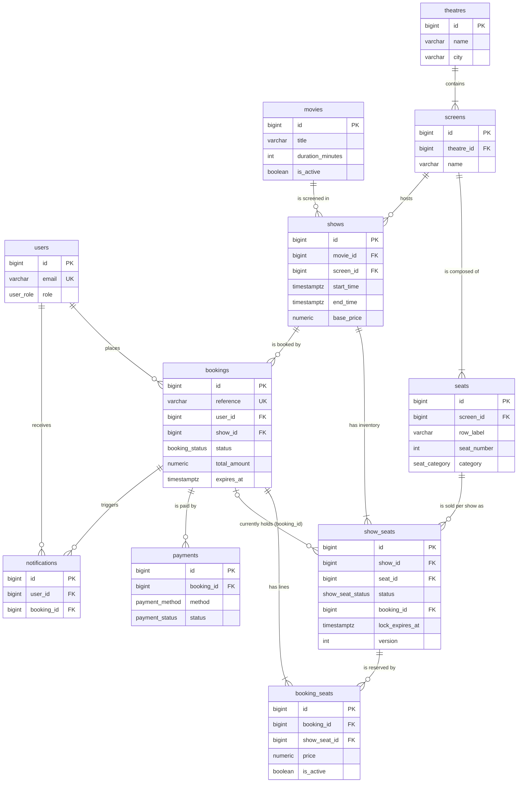

# Database Design

BookMySeat uses **PostgreSQL** (developed on PostgreSQL 18, compatible with 14+) through `node-postgres` with hand-written SQL. Raw SQL was chosen over an ORM on purpose: the row locks, conditional updates and constraint names that guarantee "no double booking" stay visible in the code.

Schema source of truth:

- [`backend/src/db/migrations/001_initial_schema.sql`](../backend/src/db/migrations/001_initial_schema.sql): types, tables and constraints
- [`backend/src/db/migrations/002_indexes.sql`](../backend/src/db/migrations/002_indexes.sql): secondary indexes
- [`backend/src/db/migrate.ts`](../backend/src/db/migrate.ts): migration runner

---

## 1. Entity-relationship diagram



---

## 2. Enumerated types

| Type | Values | Used by |
|---|---|---|
| `user_role` | `CUSTOMER`, `ADMIN` | `users.role` |
| `seat_category` | `REGULAR`, `PREMIUM`, `RECLINER` | `seats.category` |
| `show_status` | `SCHEDULED`, `CANCELLED` | `shows.status` |
| `show_seat_status` | `AVAILABLE`, `LOCKED`, `BOOKED` | `show_seats.status` (the seat lifecycle) |
| `booking_status` | `PENDING`, `CONFIRMED`, `CANCELLED`, `EXPIRED`, `FAILED` | `bookings.status` |
| `payment_method` | `CARD`, `UPI`, `WALLET` | `payments.method` |
| `payment_status` | `SUCCESS`, `FAILED`, `REFUNDED` | `payments.status` |

The same values exist as TypeScript enums in [`backend/src/domain/enums.ts`](../backend/src/domain/enums.ts). Native PostgreSQL enums reject any other value at the database level.

---

## 3. Tables

Every table uses a surrogate key `id BIGINT GENERATED ALWAYS AS IDENTITY PRIMARY KEY`. node-postgres is configured (in [`Database.ts`](../backend/src/db/Database.ts)) to parse `INT8` and `NUMERIC` into JS numbers.

### 3.1 `users`

| Column | Type | Null | Default | Notes |
|---|---|---|---|---|
| id | BIGINT identity | no | | PK |
| name | VARCHAR(100) | no | | |
| email | VARCHAR(254) | no | | unique (case-insensitive) |
| password_hash | VARCHAR(100) | no | | bcrypt hash |
| role | user_role | no | `'CUSTOMER'` | |
| created_at | TIMESTAMPTZ | no | `now()` | |

- `ux_users_email_lower`: UNIQUE index on `lower(email)`, so `A@x.com` and `a@x.com` cannot both exist.

### 3.2 `movies`

| Column | Type | Null | Default | Notes |
|---|---|---|---|---|
| id | BIGINT identity | no | | PK |
| title | VARCHAR(200) | no | | |
| description | TEXT | no | `''` | |
| duration_minutes | INTEGER | no | | `CHECK (duration_minutes BETWEEN 1 AND 600)` |
| language | VARCHAR(50) | no | | |
| genre | VARCHAR(50) | no | | |
| certificate | VARCHAR(5) | no | `'UA'` | `CHECK (certificate IN ('U','UA','A','S'))` |
| release_date | DATE | no | | |
| poster_url | TEXT | yes | | |
| is_active | BOOLEAN | no | `TRUE` | soft delete flag |
| created_at | TIMESTAMPTZ | no | `now()` | |

### 3.3 `theatres`

| Column | Type | Null | Default |
|---|---|---|---|
| id | BIGINT identity | no | PK |
| name | VARCHAR(150) | no | |
| city | VARCHAR(100) | no | |
| address | VARCHAR(300) | no | |
| created_at | TIMESTAMPTZ | no | `now()` |

- `ux_theatres_name_city`: UNIQUE `(name, city)`.

### 3.4 `screens`

| Column | Type | Null | Notes |
|---|---|---|---|
| id | BIGINT identity | no | PK |
| theatre_id | BIGINT | no | FK → `theatres(id)` **ON DELETE CASCADE** |
| name | VARCHAR(50) | no | |
| created_at | TIMESTAMPTZ | no | default `now()` |

- `ux_screens_theatre_name`: UNIQUE `(theatre_id, name)`.

### 3.5 `seats` (physical seats)

| Column | Type | Null | Notes |
|---|---|---|---|
| id | BIGINT identity | no | PK |
| screen_id | BIGINT | no | FK → `screens(id)` **ON DELETE CASCADE** (composition) |
| row_label | VARCHAR(3) | no | |
| seat_number | INTEGER | no | `CHECK (seat_number > 0)` |
| category | seat_category | no | default `'REGULAR'` |

- `ux_seats_position`: UNIQUE `(screen_id, row_label, seat_number)`.

### 3.6 `shows`

| Column | Type | Null | Notes |
|---|---|---|---|
| id | BIGINT identity | no | PK |
| movie_id | BIGINT | no | FK → `movies(id)` **ON DELETE RESTRICT** |
| screen_id | BIGINT | no | FK → `screens(id)` **ON DELETE RESTRICT** |
| start_time | TIMESTAMPTZ | no | |
| end_time | TIMESTAMPTZ | no | computed by `ShowService`: start + runtime + 15 min cleaning buffer |
| base_price | NUMERIC(10,2) | no | `CHECK (base_price > 0)` |
| status | show_status | no | default `'SCHEDULED'` |
| created_at | TIMESTAMPTZ | no | default `now()` |

Constraints:

- `ck_shows_time_order`: `CHECK (end_time > start_time)`.
- `ex_shows_no_overlap`: the **exclusion constraint**:

  ```sql
  EXCLUDE USING gist (screen_id WITH =, tstzrange(start_time, end_time) WITH &&)
  WHERE (status = 'SCHEDULED')
  ```

  No two scheduled shows on the same screen can have overlapping time ranges. This needs the `btree_gist` extension (created by migration 001) so that `=` on a BIGINT can sit in a GiST index. A violation raises SQLSTATE `23P01`, which the API maps to `409 SHOW_OVERLAP`. Cancelled shows are excluded from the check.

### 3.7 `bookings`

| Column | Type | Null | Default | Notes |
|---|---|---|---|---|
| id | BIGINT identity | no | | PK |
| reference | VARCHAR(16) | no | | UNIQUE, e.g. `BMS-7QK2M9XA` |
| user_id | BIGINT | no | | FK → `users(id)` ON DELETE RESTRICT |
| show_id | BIGINT | no | | FK → `shows(id)` ON DELETE RESTRICT |
| status | booking_status | no | `'PENDING'` | |
| subtotal | NUMERIC(10,2) | no | | `CHECK (subtotal >= 0)`, sum of ticket prices |
| total_amount | NUMERIC(10,2) | no | | `CHECK (total_amount >= 0)`, incl. surcharge, fee, tax |
| price_breakdown | JSONB | no | `'[]'` | snapshot of price lines |
| idempotency_key | VARCHAR(100) | yes | | client `Idempotency-Key` |
| expires_at | TIMESTAMPTZ | no | | end of the temporary seat hold |
| confirmed_at | TIMESTAMPTZ | yes | | |
| cancelled_at | TIMESTAMPTZ | yes | | |
| created_at / updated_at | TIMESTAMPTZ | no | `now()` | |

Constraints:

- `ux_bookings_idempotency`: UNIQUE `(user_id, idempotency_key)`. NULL keys never collide, so requests without a key are unaffected.
- `ck_bookings_confirmed_at`: `CHECK (status <> 'CONFIRMED' OR confirmed_at IS NOT NULL)`.

### 3.8 `show_seats` (per-show seat inventory, the row that gets locked)

| Column | Type | Null | Default | Notes |
|---|---|---|---|---|
| id | BIGINT identity | no | | PK |
| show_id | BIGINT | no | | FK → `shows(id)` **ON DELETE CASCADE** |
| seat_id | BIGINT | no | | FK → `seats(id)` ON DELETE RESTRICT |
| status | show_seat_status | no | `'AVAILABLE'` | |
| booking_id | BIGINT | yes | | FK → `bookings(id)` ON DELETE SET NULL; the booking that currently holds or owns the seat |
| lock_expires_at | TIMESTAMPTZ | yes | | set while LOCKED |
| version | INTEGER | no | `0` | optimistic-locking counter, incremented by every write |
| updated_at | TIMESTAMPTZ | no | `now()` | |

Constraints:

- `ux_show_seats_show_seat`: UNIQUE `(show_id, seat_id)`, one inventory row per seat per show.
- `ck_show_seats_state`: the **state-machine CHECK**:

  ```sql
  (status = 'AVAILABLE' AND booking_id IS NULL     AND lock_expires_at IS NULL) OR
  (status = 'LOCKED'    AND booking_id IS NOT NULL AND lock_expires_at IS NOT NULL) OR
  (status = 'BOOKED'    AND booking_id IS NOT NULL AND lock_expires_at IS NULL)
  ```

  A seat can never be "BOOKED by nobody" or "AVAILABLE but owned by a booking".

The rows are created by `PgShowRepository.createWithInventory` in the same transaction as the show (`INSERT INTO show_seats (show_id, seat_id) SELECT $1, id FROM seats WHERE screen_id = $2`).

### 3.9 `booking_seats` (booking line items)

| Column | Type | Null | Default | Notes |
|---|---|---|---|---|
| id | BIGINT identity | no | | PK |
| booking_id | BIGINT | no | | FK → `bookings(id)` ON DELETE CASCADE |
| show_seat_id | BIGINT | no | | FK → `show_seats(id)` ON DELETE RESTRICT |
| price | NUMERIC(10,2) | no | | `CHECK (price >= 0)`, price at booking time |
| is_active | BOOLEAN | no | `TRUE` | false once the booking is CANCELLED/EXPIRED/FAILED |

Constraints:

- `ux_booking_seats_line`: UNIQUE `(booking_id, show_seat_id)`.
- **`ux_booking_seats_one_active_per_show_seat`**: the double-booking guard of last resort:

  ```sql
  CREATE UNIQUE INDEX ux_booking_seats_one_active_per_show_seat
      ON booking_seats (show_seat_id) WHERE is_active;
  ```

  At most one active (pending or confirmed) reservation line can exist for any show seat, regardless of what the application code does. Inactive history lines are unlimited. A violation (`23505` on this constraint name) is translated by `BookingService.withConstraintMapping` into `409 SEAT_UNAVAILABLE`.

### 3.10 `payments`

| Column | Type | Null | Notes |
|---|---|---|---|
| id | BIGINT identity | no | PK |
| booking_id | BIGINT | no | FK → `bookings(id)` ON DELETE RESTRICT |
| amount | NUMERIC(10,2) | no | `CHECK (amount >= 0)` |
| method | payment_method | no | |
| status | payment_status | no | |
| gateway | VARCHAR(50) | no | e.g. `LEGACY_PAY` |
| transaction_ref | VARCHAR(100) | yes | gateway transaction id |
| failure_reason | VARCHAR(300) | yes | decline message |
| idempotency_key | VARCHAR(100) | yes | |
| created_at | TIMESTAMPTZ | no | default `now()` |
| refunded_at | TIMESTAMPTZ | yes | |

Constraints:

- `ux_payments_idempotency`: UNIQUE `(booking_id, idempotency_key)`.
- **`ux_payments_one_success_per_booking`**: `UNIQUE (booking_id) WHERE status IN ('SUCCESS','REFUNDED')`. A booking can be charged successfully at most once. The constraint still holds after a refund, so a refunded booking cannot be charged again.

### 3.11 `notifications` (output of the Observer pattern)

| Column | Type | Null | Notes |
|---|---|---|---|
| id | BIGINT identity | no | PK |
| user_id | BIGINT | no | FK → `users(id)` ON DELETE CASCADE |
| booking_id | BIGINT | yes | FK → `bookings(id)` ON DELETE CASCADE |
| type | VARCHAR(40) | no | `BOOKING_CONFIRMED`, `BOOKING_CANCELLED`, `PAYMENT_FAILED`, `BOOKING_EXPIRED` |
| channel | VARCHAR(20) | no | `EMAIL` / `SMS` |
| subject | VARCHAR(200) | no | |
| message | TEXT | no | |
| created_at | TIMESTAMPTZ | no | default `now()` |

### 3.12 `schema_migrations`

Created by the migration runner: `filename VARCHAR(200) PRIMARY KEY, applied_at TIMESTAMPTZ`.

---

## 4. Secondary indexes (`002_indexes.sql`)

| Index | Definition | Query it supports |
|---|---|---|
| `ix_movies_active_release` | `movies (is_active, release_date DESC)` | `PgMovieRepository.search`: active movies, newest first |
| `ix_movies_genre` | `movies (genre)` | genre filter |
| `ix_movies_language` | `movies (language)` | language filter |
| `ix_theatres_city` | `theatres (city)` | `GET /theatres?city=` |
| `ix_shows_movie_start` | `shows (movie_id, start_time)` | `GET /movies/:id/shows`: upcoming shows of a movie in a time window |
| `ix_shows_screen_start` | `shows (screen_id, start_time)` | screen schedules |
| `ix_show_seats_show_status` | `show_seats (show_id, status)` | seat map + available-seat counts in show listings |
| `ix_show_seats_booking` | `show_seats (booking_id) WHERE booking_id IS NOT NULL` | `releaseForBooking`, `markBooked`, orphan sweep |
| `ix_bookings_user_created` | `bookings (user_id, created_at DESC)` | booking history (`GET /bookings`) |
| `ix_bookings_pending_expiry` | `bookings (expires_at) WHERE status = 'PENDING'` | `findExpiredPendingIds` for the hold-expiry sweeper; a small partial index |
| `ix_bookings_show` | `bookings (show_id)` | admin revenue per movie, joins |
| `ix_booking_seats_booking` | `booking_seats (booking_id)` | loading the lines of a booking |
| `ix_payments_booking` | `payments (booking_id)` | latest payment per booking (LATERAL join) |
| `ix_notifications_user` | `notifications (user_id, created_at DESC)` | `GET /notifications` |

Implicit indexes come from every UNIQUE constraint above (e.g. `(show_id, seat_id)` serves the hot `findByShowAndSeatIds ... FOR UPDATE` lookup).

---

## 5. Normalisation

- **1NF:** every column is atomic. Seats are rows, not a list column. The one exception is `bookings.price_breakdown` (see below).
- **2NF:** all tables use a single-column surrogate PK, so no non-key attribute can depend on part of a composite key. Natural composite keys (`(show_id, seat_id)`, `(screen_id, row_label, seat_number)`) are enforced as UNIQUE constraints.
- **3NF:** no transitive dependencies. Examples: a show stores `screen_id`, not the theatre or city, because those are reached via `screens → theatres`; a booking stores `show_id`, not the movie title.

**Why `show_seats` is separate from `seats`.** A physical seat (row C, number 7, PREMIUM) is a fact about the auditorium and never changes. Whether it is free, held or sold is a fact about *one show*. Mixing the two would mean resetting seat state per show or duplicating the layout. `show_seats` is the classic associative entity that resolves the many-to-many between `shows` and `seats` and carries the per-show state. It is the unit of row-level locking.

**Intentional, documented denormalisation:**

1. `booking_seats.price`: the price the customer was quoted and paid. Prices are computed from `shows.base_price` × category multiplier, so they could be recomputed, but `base_price` or the pricing strategy may change later. The booking must keep its **historical** price.
2. `bookings.price_breakdown` (JSONB): an immutable snapshot of the price lines (tickets, weekend surcharge, convenience fee, GST) produced by the decorator chain at hold time. It is only displayed, never queried, so a JSON document is appropriate. `subtotal` and `total_amount` stay as proper NUMERIC columns because they are aggregated.
3. `show_seats.booking_id`: the current holder. It duplicates information that can be derived from the active `booking_seats` line, but it puts the ownership on the row we lock, so `markBooked` / `releaseForBooking` can say `WHERE booking_id = $1` and never touch someone else's seat. Consistency between the two is checked by the concurrency tests (`dbInvariants`).

---

## 6. Referential integrity

| FK | ON DELETE | Rationale |
|---|---|---|
| screens.theatre_id → theatres | CASCADE | composition: a screen does not exist without its theatre |
| seats.screen_id → screens | CASCADE | composition |
| shows.movie_id → movies | RESTRICT | never lose show/booking history; movies are soft-deleted (`is_active`) |
| shows.screen_id → screens | RESTRICT | a screen with shows cannot be removed |
| show_seats.show_id → shows | CASCADE | inventory belongs to its show |
| show_seats.seat_id → seats | RESTRICT | |
| show_seats.booking_id → bookings | SET NULL | |
| bookings.user_id / show_id | RESTRICT | financial records are kept |
| booking_seats.booking_id → bookings | CASCADE | line items belong to the booking |
| booking_seats.show_seat_id → show_seats | RESTRICT | |
| payments.booking_id → bookings | RESTRICT | payments are never deleted |
| notifications.user_id / booking_id | CASCADE | |

An FK violation that reaches the API is reported as `409 REFERENCE_CONFLICT` (SQLSTATE 23503).

---

## 7. Transactions and isolation

- All multi-statement writes go through [`TransactionManager.run`](../backend/src/db/TransactionManager.ts): `BEGIN ISOLATION LEVEL READ COMMITTED` → work → `COMMIT`. Any thrown error causes a `ROLLBACK`. On `40001` (serialization failure) or `40P01` (deadlock detected) the whole unit of work is retried up to 3 times with jittered back-off.
- The **Unit of Work** ([`PgUnitOfWork.ts`](../backend/src/repositories/pg/PgUnitOfWork.ts)) binds every repository to the same checked-out client, so a service sees one consistent transaction.
- **Why READ COMMITTED plus explicit row locks, not SERIALIZABLE.**
  - The critical invariant is per row ("this show seat has one owner"). `SELECT … FOR UPDATE` and version-guarded `UPDATE`s give exactly that guarantee with predictable blocking.
  - Under SERIALIZABLE, a hot seat contended by 50 users would produce many serialization failures that must be retried, which burns CPU and still ends in 49 conflicts.
  - With row locks, the losers wait milliseconds, re-read the committed row and fail fast with a meaningful `SEAT_UNAVAILABLE`.
  - The unique and CHECK constraints are enforced under any isolation level, so the database stays correct even if a code path forgot a lock.

  See [CONCURRENCY_DESIGN.md](CONCURRENCY_DESIGN.md) for the full analysis.
- Transaction-scoped advisory locks (`pg_advisory_xact_lock(hashtextextended(key, 0))`) serialise duplicate idempotent requests. They are released automatically at COMMIT/ROLLBACK.

---

## 8. Entity ↔ table ↔ class mapping

| Table | Domain class | Repository (interface → implementation) |
|---|---|---|
| users | `User` (abstract) → `Customer`, `Admin` via `UserFactory` ([User.ts](../backend/src/domain/User.ts)) | `UserRepository` → `PgUserRepository` |
| movies | `Movie` | `MovieReader` + `MovieWriter` (= `MovieRepository`) → `PgMovieRepository` |
| theatres | `Theatre` (aggregates `Screen`) | `TheatreRepository` → `PgTheatreRepository` |
| screens | `Screen` (composes `Seat`) | `TheatreRepository` |
| seats | `Seat` | `TheatreRepository` |
| shows | `Show` | `ShowRepository` → `PgShowRepository` |
| show_seats | `ShowSeat` (state machine) | `ShowSeatRepository` → `PgShowSeatRepository` |
| bookings | `Booking` aggregate root, built from `BookingDraft` by `BookingBuilder` | `BookingRepository` → `PgBookingRepository` |
| booking_seats | `BookingSeat` (value inside `Booking`) | `BookingRepository` |
| payments | `Payment` | `PaymentRepository` → `PgPaymentRepository` |
| notifications | `NotificationRecord` | `NotificationRepository` → `PgNotificationRepository` |
| (aggregates) | `AdminStats` read model | `ReportingRepository` → `PgReportingRepository` |
| (advisory locks) | n/a | `AdvisoryLockRepository` → `PgAdvisoryLockRepository` |

Column `snake_case` ↔ property `camelCase` mapping is done in each repository's `to…()` mapper. List and detail screens use flattened read models ([`readModels.ts`](../backend/src/repositories/readModels.ts)): `ShowListing`, `ShowDetails`, `BookingSummary`.

---

## 9. Migrations

The runner ([`backend/src/db/migrate.ts`](../backend/src/db/migrate.ts)) is a minimal forward-only migrator:

1. Takes a session advisory lock (`pg_advisory_lock(727274)`) so two processes (e.g. a server start and a test run) never migrate concurrently.
2. With `--reset`, runs `DROP SCHEMA public CASCADE; CREATE SCHEMA public;` first. This is for development only.
3. Creates `schema_migrations` if missing, reads the `*.sql` files in `migrations/` in lexical order, and applies each unapplied file **in its own transaction**, recording it in `schema_migrations`. A failing file rolls back completely and aborts the run.

Commands (from the repo root):

```bash
npm --prefix backend run migrate        # apply pending migrations
npm --prefix backend run migrate -- --reset
npm run db:reset                        # drop schema, migrate, seed demo data
```

The server also runs pending migrations on start-up (`server.ts`). The test suite rebuilds `bookmyseat_test` from scratch in `tests/helpers/globalSetup.ts`. Running `migrate` twice prints `schema is up to date`, which was verified.

---

## 10. Inspecting state (sample SQL)

```bash
psql -h 127.0.0.1 -p 5433 -U bookmyseat bookmyseat
```

```sql
-- Seat map of a show with effective status (expired locks count as available)
SELECT se.row_label || se.seat_number AS seat, se.category, ss.status, ss.booking_id, ss.lock_expires_at,
       CASE WHEN ss.status = 'LOCKED' AND ss.lock_expires_at <= now() THEN 'AVAILABLE (expired lock)'
            ELSE ss.status::text END AS effective
FROM show_seats ss JOIN seats se ON se.id = ss.seat_id
WHERE ss.show_id = 9 ORDER BY se.row_label, se.seat_number;

-- Proof of no double booking: must return zero rows
SELECT show_seat_id, count(*) FROM booking_seats WHERE is_active GROUP BY show_seat_id HAVING count(*) > 1;

-- Seats whose holder disagrees with the active line: must return zero rows
SELECT ss.id FROM show_seats ss
WHERE ss.status <> 'AVAILABLE'
  AND NOT EXISTS (SELECT 1 FROM booking_seats bs WHERE bs.show_seat_id = ss.id AND bs.is_active AND bs.booking_id = ss.booking_id);

-- Bookings by status and revenue
SELECT status, count(*) FROM bookings GROUP BY status;
SELECT sum(amount) FILTER (WHERE status = 'SUCCESS') AS revenue FROM payments;

-- Holds that the sweeper will expire
SELECT id, reference, expires_at FROM bookings WHERE status = 'PENDING' AND expires_at <= now();

-- Watch row locks live (run during the concurrency demo)
SELECT pid, mode, granted, relation::regclass FROM pg_locks WHERE relation = 'show_seats'::regclass;
```
