# UML Diagrams

All diagrams are written in PlantUML and live in [`docs/uml/`](uml/). Each one is also embedded below so it renders directly in IDE plugins and Markdown viewers that support `plantuml` code blocks. Every participant, class and method name is taken from the actual source code.

## How to render

- **VS Code / IntelliJ**: install the *PlantUML* extension and preview any `.puml` file (requires Java; Graphviz is needed for the class and use-case diagrams).
- **CLI**: download `plantuml.jar` from https://plantuml.com/download and run `java -jar plantuml.jar -tsvg docs/uml/*.puml` (SVGs are written next to the sources).
- **Online**: paste a file's contents into https://www.plantuml.com/plantuml.

> Note: the diagrams were not rendered in the build environment (no PlantUML installation was available); they use only standard PlantUML syntax.

## Index

| Diagram | File | Main code it describes |
|---|---|---|
| A. Use Case Diagram | [`use-case.puml`](uml/use-case.puml) | `backend/src/http/routes.ts` (one use case per route), `backend/src/services/*` |
| B. Class Diagram (complete backend) | [`class-diagram.puml`](uml/class-diagram.puml) | `backend/src/domain`, `repositories`, `concurrency`, `services`, `pricing`, `payments`, `notifications`, `common/errors.ts`, `db`, `http/controllers` |
| C1. Sequence - Movie browsing | [`seq-01-movie-browsing.puml`](uml/seq-01-movie-browsing.puml) | `frontend/src/pages/MoviesPage.tsx`, `backend/src/http/controllers/controllers.ts` (`MovieController.list/get`), `services/MovieService.ts`, `repositories/pg/PgMovieRepository.ts` |
| C2. Sequence - Show selection | [`seq-02-show-selection.puml`](uml/seq-02-show-selection.puml) | `frontend/src/pages/MovieDetailsPage.tsx`, `services/ShowService.ts`, `repositories/pg/PgShowRepository.ts` |
| C3. Sequence - Seat availability (Observer) | [`seq-03-seat-availability.puml`](uml/seq-03-seat-availability.puml) | `frontend/src/patterns/SeatAvailabilityPoller.ts`, `patterns/seatSelectionStrategies.ts`, `components/SeatMap.tsx`, `backend/src/services/SeatAvailabilityService.ts` |
| C4. Sequence - Successful booking (seat hold) | [`seq-04-successful-booking.puml`](uml/seq-04-successful-booking.puml) | `services/BookingService.ts#createHold`, `services/SeatLockService.ts#hold`, `concurrency/SeatLockingStrategy.ts`, `repositories/pg/PgShowSeatRepository.ts`, `PgBookingRepository.ts` |
| C5. Sequence - Concurrent booking attempts | [`seq-05-concurrent-booking.puml`](uml/seq-05-concurrent-booking.puml) | `concurrency/SeatLockingStrategy.ts`, `db/migrations/001_initial_schema.sql`, `tests/concurrency/booking-concurrency.test.ts` |
| C6. Sequence - Booking conflict in the UI | [`seq-06-booking-conflict.puml`](uml/seq-06-booking-conflict.puml) | `frontend/src/pages/SeatSelectionPage.tsx`, `api/httpClient.ts` |
| C7. Sequence - Payment success | [`seq-07-payment-success.puml`](uml/seq-07-payment-success.puml) | `services/BookingService.ts#pay`, `payments/*`, `notifications/*` |
| C8. Sequence - Payment failure | [`seq-08-payment-failure.puml`](uml/seq-08-payment-failure.puml) | `services/BookingService.ts#pay`, `payments/gateway/LegacyPaySdk.ts` (simulation rules), `tests/integration/bookings.test.ts` |
| C9. Sequence - Booking cancellation | [`seq-09-cancellation.puml`](uml/seq-09-cancellation.puml) | `domain/Booking.ts#cancel`, `services/BookingService.ts#cancel`, `frontend/src/pages/BookingPages.tsx` |
| D. Activity Diagram - Complete booking workflow | [`activity-booking.puml`](uml/activity-booking.puml) | `services/BookingService.ts`, `services/SeatLockService.ts`, `services/HoldExpiryJob.ts`, `frontend/src/pages/*` |

## A. Use Case Diagram

Actors: **Customer**, **Admin** (generalises Customer, so an admin can also book) and the system actor **Hold Expiry Job** (`HoldExpiryJob`). `Pay` *includes* hold validation (`SeatLockService.assertStillHeld`, `Booking.assertPayable`); `Refund payment` *extends* `Cancel booking` only for confirmed bookings before the cut-off (`Booking.cancel` returns `refundRequired`).

**Code:** `backend/src/http/routes.ts` (one use case per route), `backend/src/services/*`

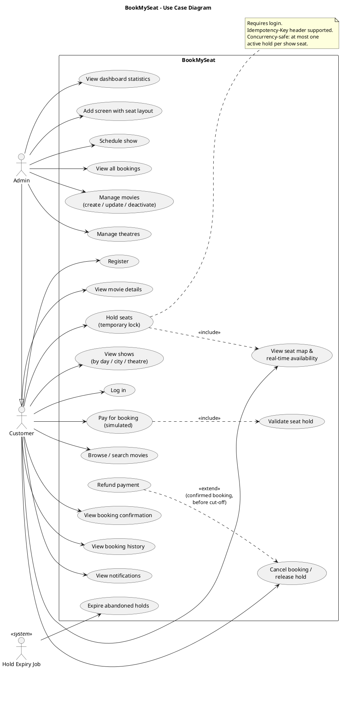

## B. Class Diagram (complete backend)

Packages mirror the source folders. Shows inheritance (`Entity` → entities, `User` → `Customer`/`Admin`, `AppError` hierarchy, abstract strategies/decorators), realization of every repository/strategy interface, **composition** (`Screen *-- Seat`, `Booking *-- BookingSeat`), **aggregation** (`Theatre o-- Screen`, `BookingEventPublisher o-- BookingEventListener`), **association** (`Show --> Movie`, `Show --> Screen`) and **dependency** (`..>`). Visibility: `+` public, `-` private (TypeScript `#private`/`private`), `#` protected.

**Code:** `backend/src/domain`, `repositories`, `concurrency`, `services`, `pricing`, `payments`, `notifications`, `common/errors.ts`, `db`, `http/controllers`

```plantuml
@startuml class-diagram
title BookMySeat - Class Diagram (backend)
skinparam classAttributeIconSize 0
skinparam packageStyle rectangle
hide empty members

' =====================================================================
package "domain" {
  abstract class Entity {
    +id: number
    #Entity(id: number)
    +equals(other: Entity): boolean
  }

  enum UserRole {
    CUSTOMER
    ADMIN
  }
  enum SeatCategory {
    REGULAR
    PREMIUM
    RECLINER
  }
  enum ShowStatus {
    SCHEDULED
    CANCELLED
  }
  enum ShowSeatStatus {
    AVAILABLE
    LOCKED
    BOOKED
  }
  enum BookingStatus {
    PENDING
    CONFIRMED
    CANCELLED
    EXPIRED
    FAILED
  }
  enum PaymentMethod {
    CARD
    UPI
    WALLET
  }
  enum PaymentStatus {
    SUCCESS
    FAILED
    REFUNDED
  }

  abstract class User {
    +name: string
    +email: string
    +createdAt: Date
    -passwordHash: string
    +{abstract} role: UserRole
    +{abstract} canManageCatalog(): boolean
    +canAccessBookingOf(ownerId: number): boolean
    +toPublic(): PublicUser
  }
  class Customer {
    +role: UserRole = CUSTOMER
    +canManageCatalog(): boolean = false
  }
  class Admin {
    +role: UserRole = ADMIN
    +canManageCatalog(): boolean = true
  }
  class UserFactory <<Factory>> {
    +{static} create(props: UserProps): User
  }

  class Movie {
    +title: string
    +description: string
    +durationMinutes: number
    +language: string
    +genre: string
    +certificate: string
    +releaseDate: string
    +posterUrl: string | null
    +isActive: boolean
    +occupiedMinutes(cleaningBufferMinutes: number = 15): number
  }

  class Theatre {
    +name: string
    +city: string
    +address: string
    -screens: Screen[]
    +screens(): Screen[]
  }
  class Screen {
    +theatreId: number
    +name: string
    -seats: Seat[]
    -capacityHint: number
    +seats(): Seat[]
    +capacity(): number
  }
  class Seat {
    +screenId: number
    +rowLabel: string
    +seatNumber: number
    +category: SeatCategory
    +label(): string
  }

  class Show {
    +movieId: number
    +screenId: number
    +startTime: Date
    +endTime: Date
    +basePrice: number
    +status: ShowStatus
    +isBookableAt(now: Date): boolean
    +minutesUntilStart(now: Date): number
    +isWeekend(): boolean
  }

  class ShowSeat <<state machine>> {
    +showId: number
    +seatId: number
    +rowLabel: string
    +seatNumber: number
    +category: SeatCategory
    +version: number
    -status: ShowSeatStatus
    -bookingId: number | null
    -lockExpiresAt: Date | null
    +hasExpiredLock(now: Date): boolean
    +isAvailableAt(now: Date): boolean
    +isHeldBy(bookingId: number, now: Date): boolean
    +effectiveStatus(now: Date): ShowSeatStatus
    +lock(bookingId: number, expiresAt: Date, now: Date): void
    +book(bookingId: number, now: Date): void
    +release(): void
  }

  class Booking <<aggregate root>> {
    +reference: string
    +userId: number
    +showId: number
    +subtotal: number
    +totalAmount: number
    +priceBreakdown: PriceLine[]
    +idempotencyKey: string | null
    +expiresAt: Date
    +createdAt: Date
    -status: BookingStatus
    -confirmedAt: Date | null
    -cancelledAt: Date | null
    -seats: BookingSeat[]
    +isHoldExpired(now: Date): boolean
    +assertPayable(now: Date): void
    +confirm(now: Date): void
    +markPaymentFailed(): void
    +expire(): void
    +cancel(now: Date, show: Show, cutoffMinutes: number): CancellationOutcome
    +isCancellable(now: Date, show: Show, cutoffMinutes: number): boolean
    -transitionToTerminal(target: BookingStatus, allowedFrom: BookingStatus[]): void
  }
  class BookingSeat <<value>> {
    +showSeatId: number
    +seatLabel: string
    +category: string
    +price: number
    +isActive: boolean
  }
  class BookingDraft <<value>> {
    +reference: string
    +userId: number
    +showId: number
    +subtotal: number
    +totalAmount: number
    +priceBreakdown: PriceLine[]
    +idempotencyKey: string | null
    +expiresAt: Date
    +seats: BookingSeat[]
  }
  class BookingBuilder <<Builder>> {
    -userId: number
    -showId: number
    -seats: BookingSeat[]
    -expiresAt: Date
    +forUser(userId: number): BookingBuilder
    +forShow(showId: number): BookingBuilder
    +withSeat(seat: BookingSeat): BookingBuilder
    +withPricing(subtotal: number, total: number, lines: PriceLine[]): BookingBuilder
    +withIdempotencyKey(key: string): BookingBuilder
    +holdUntil(expiresAt: Date): BookingBuilder
    +build(): BookingDraft
    +{static} generateReference(): string
  }

  class Payment {
    +bookingId: number
    +amount: number
    +method: PaymentMethod
    +gateway: string
    +transactionRef: string | null
    +failureReason: string | null
    +idempotencyKey: string | null
    -status: PaymentStatus
    -refundedAt: Date | null
    +markRefunded(now: Date): void
  }
}

Entity <|-- User
Entity <|-- Movie
Entity <|-- Theatre
Entity <|-- Screen
Entity <|-- Seat
Entity <|-- Show
Entity <|-- ShowSeat
Entity <|-- Booking
Entity <|-- Payment
User <|-- Customer
User <|-- Admin
UserFactory ..> Customer : creates
UserFactory ..> Admin : creates

Theatre "1" o-- "0..*" Screen : aggregates
Screen "1" *-- "1..*" Seat : composes
Show "0..*" --> "1" Movie : plays
Show "0..*" --> "1" Screen : on
ShowSeat "0..*" --> "1" Show
ShowSeat "0..*" --> "1" Seat
Booking "1" *-- "1..*" BookingSeat : line items
Booking "0..*" --> "1" Show
Booking "0..*" --> "1" User : made by
BookingSeat "0..*" --> "1" ShowSeat
Payment "0..*" --> "1" Booking
BookingBuilder ..> BookingDraft : builds
Booking ..> Show : uses (cancel rules)

' =====================================================================
package "repositories" {
  interface UserRepository {
    +findById(id: number): Promise<User>
    +findByEmail(email: string): Promise<User>
    +create(data: UserProps): Promise<User>
  }
  interface MovieReader {
    +findById(id: number): Promise<Movie>
    +search(filter: MovieFilter): Promise<Movie[]>
  }
  interface MovieWriter {
    +create(data: MovieProps): Promise<Movie>
    +update(id: number, data: MovieProps): Promise<Movie>
  }
  interface MovieRepository
  interface TheatreRepository {
    +list(city: string): Promise<Theatre[]>
    +findById(id: number): Promise<Theatre>
    +create(data): Promise<Theatre>
    +findScreenById(id: number): Promise<Screen>
    +createScreen(theatreId: number, name: string, seats: SeatCreate[]): Promise<Screen>
    +listCities(): Promise<string[]>
  }
  interface ShowRepository {
    +findById(id: number): Promise<Show>
    +findDetails(id: number, now: Date): Promise<ShowDetails>
    +listForMovie(movieId: number, filter: ShowFilter, now: Date): Promise<ShowListing[]>
    +createWithInventory(data): Promise<Show>
  }
  interface ShowSeatRepository {
    +findByShow(showId: number): Promise<ShowSeat[]>
    +findByShowAndSeatIds(showId: number, seatIds: number[], options: LockOptions): Promise<ShowSeat[]>
    +findByIds(ids: number[], options: LockOptions): Promise<ShowSeat[]>
    +lockSeats(ids: number[], bookingId: number, expiresAt: Date): Promise<void>
    +lockSeatsIfUnchanged(seats: IdVersion[], bookingId: number, expiresAt: Date): Promise<number[]>
    +markBooked(ids: number[], bookingId: number): Promise<number>
    +releaseForBooking(bookingId: number, ids: number[]): Promise<number>
    +releaseOrphanedLocks(now: Date): Promise<number>
  }
  interface BookingRepository {
    +createHeader(draft: BookingDraft): Promise<number>
    +addLines(bookingId: number, seats: BookingSeat[]): Promise<void>
    +findById(id: number, options: LockOptions): Promise<Booking>
    +findByIds(ids: number[], options: LockOptions): Promise<Booking[]>
    +findByUserAndIdempotencyKey(userId: number, key: string): Promise<Booking>
    +save(booking: Booking): Promise<void>
    +deactivateLinesForShowSeats(showSeatIds: number[]): Promise<void>
    +findExpiredPendingIds(now: Date, limit: number): Promise<number[]>
    +findSummary(id: number): Promise<BookingSummary>
    +listSummariesByUser(userId: number): Promise<BookingSummary[]>
    +listSummaries(filter): Promise<BookingSummary[]>
  }
  interface PaymentRepository {
    +create(payment: NewPayment): Promise<Payment>
    +findByBookingAndKey(bookingId: number, key: string): Promise<Payment>
    +findSuccessfulByBooking(bookingId: number): Promise<Payment>
    +save(payment: Payment): Promise<void>
  }
  interface NotificationRepository {
    +create(n: NotificationRecord): Promise<NotificationRecord>
    +listByUser(userId: number, limit: number): Promise<NotificationRecord[]>
  }
  interface ReportingRepository {
    +stats(now: Date): Promise<AdminStats>
  }
  interface AdvisoryLockRepository {
    +lockForTransaction(key: string): Promise<void>
  }
  interface UnitOfWork {
    +users: UserRepository
    +movies: MovieRepository
    +theatres: TheatreRepository
    +shows: ShowRepository
    +showSeats: ShowSeatRepository
    +bookings: BookingRepository
    +payments: PaymentRepository
    +notifications: NotificationRepository
    +reporting: ReportingRepository
    +advisoryLocks: AdvisoryLockRepository
  }
  interface UnitOfWorkFactory {
    +db: UnitOfWork
    +transaction<T>(work: UnitOfWork => Promise<T>): Promise<T>
  }

  package "pg (PostgreSQL implementations)" {
    class PgUserRepository
    class PgMovieRepository
    class PgTheatreRepository
    class PgShowRepository
    class PgShowSeatRepository
    class PgBookingRepository
    class PgPaymentRepository
    class PgNotificationRepository
    class PgReportingRepository
    class PgAdvisoryLockRepository
    class PgUnitOfWorkFactory {
      +db: UnitOfWork
      -tx: TransactionManager
      +transaction<T>(work): Promise<T>
    }
  }
}

MovieReader <|-- MovieRepository
MovieWriter <|-- MovieRepository
UserRepository <|.. PgUserRepository
MovieRepository <|.. PgMovieRepository
TheatreRepository <|.. PgTheatreRepository
ShowRepository <|.. PgShowRepository
ShowSeatRepository <|.. PgShowSeatRepository
BookingRepository <|.. PgBookingRepository
PaymentRepository <|.. PgPaymentRepository
NotificationRepository <|.. PgNotificationRepository
ReportingRepository <|.. PgReportingRepository
AdvisoryLockRepository <|.. PgAdvisoryLockRepository
UnitOfWorkFactory <|.. PgUnitOfWorkFactory
UnitOfWorkFactory --> UnitOfWork
UnitOfWork o-- ShowSeatRepository
UnitOfWork o-- BookingRepository
UnitOfWork o-- PaymentRepository

' =====================================================================
package "db" {
  class Database <<Singleton>> {
    -{static} instance: Database
    +pool: pg.Pool
    -Database(connectionString: string, max: number)
    +{static} getInstance(): Database
    +{static} close(): Promise<void>
  }
  class TransactionManager {
    -pool: pg.Pool
    +run<T>(work: Queryable => Promise<T>, options: TransactionOptions): Promise<T>
  }
  interface Queryable {
    +query(text: string, params: unknown[]): Promise<QueryResult>
  }
}
PgUnitOfWorkFactory *-- TransactionManager
TransactionManager ..> Queryable : BEGIN/COMMIT/ROLLBACK\n+ retry 40001/40P01
PgShowSeatRepository ..> Queryable

' =====================================================================
package "concurrency" {
  interface SeatLockingStrategy <<Strategy>> {
    +name: SeatLockingStrategyName
    +reserveCandidates(uow: UnitOfWork, showId: number, seatIds: number[], now: Date): Promise<ShowSeat[]>
    +claim(uow: UnitOfWork, seats: ShowSeat[], bookingId: number, expiresAt: Date): Promise<void>
  }
  abstract class AbstractSeatLockingStrategy <<Template Method>> {
    +reserveCandidates(uow, showId, seatIds, now): Promise<ShowSeat[]>
    #{abstract} loadCandidates(uow, showId, seatIds): Promise<ShowSeat[]>
    +{abstract} claim(uow, seats, bookingId, expiresAt): Promise<void>
  }
  class PessimisticSeatLockingStrategy {
    +name = PESSIMISTIC
    #loadCandidates(): SELECT ... FOR UPDATE
    +claim(): lockSeats()
  }
  class OptimisticSeatLockingStrategy {
    +name = OPTIMISTIC
    #loadCandidates(): plain SELECT
    +claim(): lockSeatsIfUnchanged() (version CAS)
  }
}
SeatLockingStrategy <|.. AbstractSeatLockingStrategy
AbstractSeatLockingStrategy <|-- PessimisticSeatLockingStrategy
AbstractSeatLockingStrategy <|-- OptimisticSeatLockingStrategy
AbstractSeatLockingStrategy ..> ShowSeatRepository

' =====================================================================
package "pricing" {
  interface SeatPricingStrategy <<Strategy>> {
    +name: string
    +priceForSeat(category: SeatCategory, basePrice: number): number
  }
  class CategoryPricingStrategy {
    +{static} MULTIPLIERS: Record<SeatCategory, number>
  }
  class FlatPricingStrategy
  interface PriceCalculator {
    +calculate(context: PricingContext): PriceQuote
  }
  class BasePriceCalculator {
    -strategy: SeatPricingStrategy
  }
  abstract class PriceCalculatorDecorator <<Decorator>> {
    #inner: PriceCalculator
    +calculate(context: PricingContext): PriceQuote
    #{abstract} extraCharge(quote: PriceQuote, context: PricingContext): PriceLine
  }
  class WeekendSurchargeDecorator {
    -rate: number
  }
  class ConvenienceFeeDecorator {
    -feePerSeat: number
  }
  class TaxDecorator {
    -rate: number
  }
  class PriceCalculatorFactory <<Factory>> {
    +{static} createStrategy(name): SeatPricingStrategy
    +{static} create(cfg: PricingConfig): PriceCalculator
  }
}
SeatPricingStrategy <|.. CategoryPricingStrategy
SeatPricingStrategy <|.. FlatPricingStrategy
PriceCalculator <|.. BasePriceCalculator
PriceCalculator <|.. PriceCalculatorDecorator
PriceCalculatorDecorator <|-- WeekendSurchargeDecorator
PriceCalculatorDecorator <|-- ConvenienceFeeDecorator
PriceCalculatorDecorator <|-- TaxDecorator
PriceCalculatorDecorator o-- "1" PriceCalculator : wraps
BasePriceCalculator --> SeatPricingStrategy
PriceCalculatorFactory ..> PriceCalculator : builds chain

' =====================================================================
package "payments" {
  interface PaymentProcessor <<Strategy>> {
    +method: PaymentMethod
    +pay(request: PaymentRequest): Promise<PaymentResult>
  }
  interface RefundProcessor {
    +refund(transactionRef: string, amount: number): Promise<RefundResult>
  }
  abstract class BasePaymentStrategy <<Template Method>> {
    #gateway: PaymentGateway
    #{abstract} instrumentType: InstrumentType
    +pay(request: PaymentRequest): Promise<PaymentResult>
    +refund(transactionRef: string, amount: number): Promise<RefundResult>
    #{abstract} validate(details): string[]
    #{abstract} tokenise(details): string
    #{abstract} mask(details): string
  }
  class CardPaymentStrategy
  class UpiPaymentStrategy
  class WalletPaymentStrategy
  class PaymentStrategyFactory <<Factory>> {
    -strategies: Map<PaymentMethod, PaymentStrategy>
    +register(strategy: PaymentStrategy): PaymentStrategyFactory
    +get(method: PaymentMethod): PaymentStrategy
    +supportedMethods(): PaymentMethod[]
    +{static} withDefaults(gateway: PaymentGateway): PaymentStrategyFactory
  }
  class PaymentService <<Facade>> {
    -factory: PaymentStrategyFactory
    +charge(method, amount, bookingReference, details): Promise<PaymentResult>
    +refund(method, transactionRef, amount): Promise<RefundResult>
  }
  interface PaymentGateway {
    +name: string
    +charge(request: GatewayChargeRequest): Promise<GatewayResult>
    +refund(transactionRef: string, amount: number): Promise<GatewayResult>
  }
  class LegacyPayGatewayAdapter <<Adapter>> {
    -sdk: LegacyPaySdk
    +name = LEGACY_PAY
  }
  class LegacyPaySdk <<third-party>> {
    +makeTransaction(payload: LegacyTxnPayload, callback): void
    +reverseTransaction(txnId: string, amountPaise: number, callback): void
  }
  class GatewayUnavailableError
}
PaymentProcessor <|.. BasePaymentStrategy
RefundProcessor <|.. BasePaymentStrategy
BasePaymentStrategy <|-- CardPaymentStrategy
BasePaymentStrategy <|-- UpiPaymentStrategy
BasePaymentStrategy <|-- WalletPaymentStrategy
BasePaymentStrategy --> PaymentGateway
PaymentGateway <|.. LegacyPayGatewayAdapter
LegacyPayGatewayAdapter --> LegacyPaySdk : adapts
LegacyPayGatewayAdapter ..> GatewayUnavailableError : throws
PaymentStrategyFactory o-- "0..*" BasePaymentStrategy
PaymentService --> PaymentStrategyFactory

' =====================================================================
package "notifications" {
  interface BookingEventListener <<Observer>> {
    +name: string
    +handle(event: BookingEvent): Promise<void>
  }
  class BookingEventPublisher <<Subject>> {
    -subscriptions: Subscription[]
    +subscribe(listener: BookingEventListener, types: BookingEventType[]): Unsubscribe
    +publish(event: BookingEvent): Promise<void>
  }
  class NotificationService {
    -users: UserRepository
    -notifications: NotificationRepository
    -channels: NotificationChannel[]
    +handle(event: BookingEvent): Promise<void>
  }
  class AuditLogListener {
    +entries: BookingEvent[]
    +handle(event: BookingEvent): Promise<void>
  }
  interface NotificationChannel {
    +name: string
    +send(recipient, subject: string, message: string): Promise<void>
  }
  class EmailChannel
  class SmsChannel
}
BookingEventListener <|.. NotificationService
BookingEventListener <|.. AuditLogListener
BookingEventPublisher o-- "0..*" BookingEventListener : notifies
NotificationChannel <|.. EmailChannel
NotificationChannel <|.. SmsChannel
NotificationService o-- "1..*" NotificationChannel
NotificationService ..> NotificationRepository

' =====================================================================
package "services" {
  class BookingService <<Application Service>> {
    -uowFactory: UnitOfWorkFactory
    -seatLocks: SeatLockService
    -payments: PaymentService
    -pricing: PriceCalculator
    -events: BookingEventPublisher
    -clock: Clock
    -policy: BookingPolicy
    +createHold(user: User, input, idempotencyKey: string): Promise<HoldResult>
    +pay(user: User, bookingId: number, input, idempotencyKey: string): Promise<BookingView>
    +cancel(user: User, bookingId: number): Promise<BookingView>
    +get(user: User, bookingId: number): Promise<BookingView>
    +listForUser(user: User): Promise<BookingView[]>
    +listAll(filter): Promise<BookingView[]>
    -authorize(user: User, booking: Booking): void
    -withConstraintMapping(seatIds, work): Promise<T>
  }
  class SeatLockService {
    +strategy: SeatLockingStrategy
    +hold(uow: UnitOfWork, params): Promise<Booking>
    +lockBookingForUpdate(uow: UnitOfWork, bookingId: number): Promise<LockedBooking>
    +assertStillHeld(booking: Booking, seats: ShowSeat[], now: Date): void
    +confirmSeats(uow, booking, seats, now): Promise<void>
    +releaseSeats(uow, booking): Promise<number>
    +expireHold(uow, booking): Promise<void>
    -reclaimExpiredHolds(uow, seats, now): Promise<void>
  }
  class HoldExpiryJob {
    -timer: Timeout
    +start(intervalMs: number): void
    +stop(): void
    +runOnce(): Promise<number>
  }
  class SeatAvailabilityService {
    -pricing: SeatPricingStrategy
    +getSeatMap(showId: number): Promise<SeatMap>
  }
  class MovieService {
    -reader: MovieReader
    -writer: MovieWriter
    +list(filter): Promise<Movie[]>
    +get(id: number): Promise<Movie>
    +create(data): Promise<Movie>
    +update(id: number, data): Promise<Movie>
    +deactivate(id: number): Promise<Movie>
  }
  class TheatreService {
    +list(city: string): Promise<Theatre[]>
    +listCities(): Promise<string[]>
    +get(id: number): Promise<Theatre>
    +create(data): Promise<Theatre>
    +getScreen(id: number): Promise<Screen>
    +addScreen(theatreId: number, name: string, layout: LayoutSpec): Promise<Screen>
  }
  class SeatLayoutFactory <<Factory>> {
    +{static} PRESETS: Record<Preset, RowSpec[]>
    +{static} create(spec: LayoutSpec): SeatCreate[]
  }
  class ShowService {
    +listForMovie(movieId: number, filter): Promise<ShowListing[]>
    +get(id: number): Promise<ShowDetails>
    +create(input): Promise<Show>
  }
  class AuthService {
    -users: UserRepository
    -hasher: PasswordHasher
    -tokens: TokenService
    +register(input): Promise<AuthResult>
    +login(input): Promise<AuthResult>
    +authenticate(token: string): Promise<User>
  }
  interface PasswordHasher {
    +hash(plain: string): Promise<string>
    +verify(plain: string, hash: string): Promise<boolean>
  }
  interface TokenService {
    +issue(payload: TokenPayload): string
    +verify(token: string): TokenPayload
  }
  class BcryptPasswordHasher
  class JwtTokenService
  class AdminService {
    -reporting: ReportingRepository
    +stats(): Promise<AdminStats>
  }
  interface Clock {
    +now(): Date
  }
  class SystemClock
  class FixedClock
}
BookingService --> UnitOfWorkFactory
BookingService --> SeatLockService
BookingService --> PaymentService
BookingService --> PriceCalculator
BookingService --> BookingEventPublisher
BookingService --> Clock
BookingService ..> BookingBuilder : uses
SeatLockService --> SeatLockingStrategy
HoldExpiryJob --> SeatLockService
HoldExpiryJob --> BookingEventPublisher
HoldExpiryJob --> UnitOfWorkFactory
SeatAvailabilityService --> SeatPricingStrategy
SeatAvailabilityService --> UnitOfWorkFactory
MovieService --> MovieReader
MovieService --> MovieWriter
TheatreService ..> SeatLayoutFactory
TheatreService --> UnitOfWorkFactory
ShowService --> UnitOfWorkFactory
AuthService --> UserRepository
AuthService --> PasswordHasher
AuthService --> TokenService
PasswordHasher <|.. BcryptPasswordHasher
TokenService <|.. JwtTokenService
AdminService --> ReportingRepository
Clock <|.. SystemClock
Clock <|.. FixedClock

' =====================================================================
package "errors" {
  abstract class AppError {
    +{abstract} statusCode: number
    +{abstract} code: string
    +details: unknown
    +toJSON(): ErrorBody
  }
  class ValidationError <<400>>
  class UnauthorizedError <<401>>
  class PaymentFailedError <<402>>
  class ForbiddenError <<403>>
  class NotFoundError <<404>>
  class ConflictError <<409>>
  class SeatUnavailableError <<409>>
  class HoldExpiredError <<410>>
  class BusinessRuleError <<422>>
}
AppError <|-- ValidationError
AppError <|-- UnauthorizedError
AppError <|-- PaymentFailedError
AppError <|-- ForbiddenError
AppError <|-- NotFoundError
AppError <|-- ConflictError
AppError <|-- BusinessRuleError
ConflictError <|-- SeatUnavailableError
ConflictError <|-- HoldExpiredError
AbstractSeatLockingStrategy ..> SeatUnavailableError : throws
SeatLockService ..> HoldExpiredError : throws

' =====================================================================
package "http" {
  class BookingController {
    +createHold(req, res)
    +pay(req, res)
    +cancel(req, res)
    +get(req, res)
    +listMine(req, res)
    +myNotifications(req, res)
  }
  class MovieController
  class TheatreController
  class ShowController
  class AuthController
  class AdminController
}
BookingController --> BookingService
MovieController --> MovieService
MovieController --> ShowService
TheatreController --> TheatreService
ShowController --> ShowService
ShowController --> SeatAvailabilityService
AuthController --> AuthService
AdminController --> AdminService
AdminController --> BookingService
@enduml
```

## C1. Sequence - Movie browsing

Public read path. `optionalAuthenticate` lets admins see inactive movies; customers never do.

**Code:** `frontend/src/pages/MoviesPage.tsx`, `backend/src/http/controllers/controllers.ts` (`MovieController.list/get`), `services/MovieService.ts`, `repositories/pg/PgMovieRepository.ts`

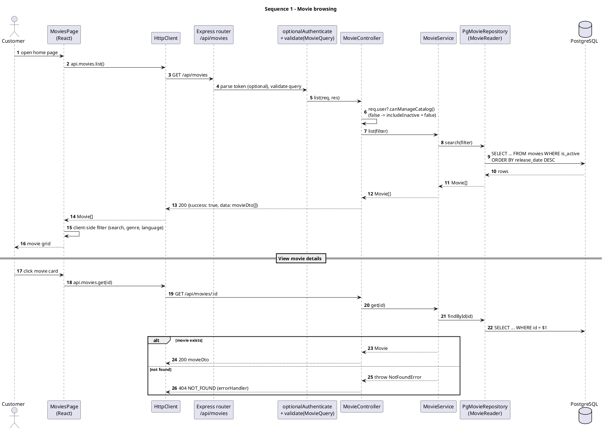

## C2. Sequence - Show selection

Upcoming shows grouped by day / city / theatre; available-seat counts treat expired locks as free.

**Code:** `frontend/src/pages/MovieDetailsPage.tsx`, `services/ShowService.ts`, `repositories/pg/PgShowRepository.ts`

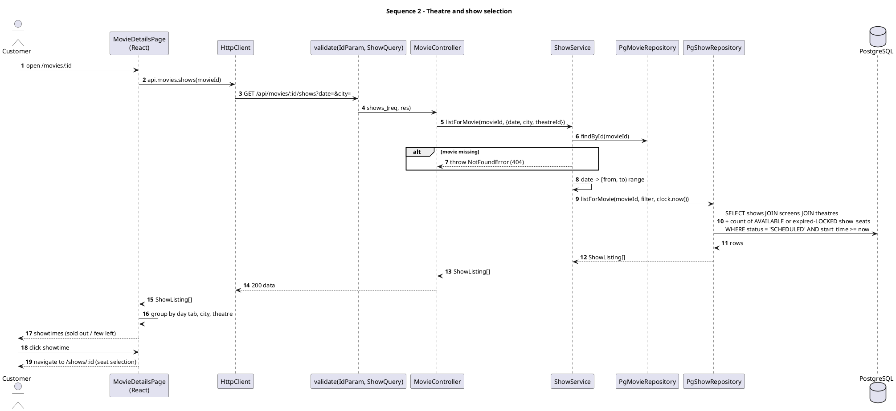

## C3. Sequence - Seat availability (Observer)

`SeatAvailabilityPoller` (Subject) polls and notifies the page; the server reports the *effective* status of each seat. Selection behaviour is delegated to a `SeatSelectionStrategy`.

**Code:** `frontend/src/patterns/SeatAvailabilityPoller.ts`, `patterns/seatSelectionStrategies.ts`, `components/SeatMap.tsx`, `backend/src/services/SeatAvailabilityService.ts`

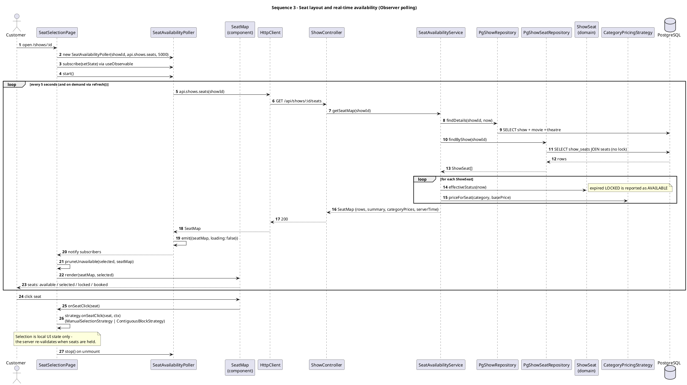

## C4. Sequence - Successful booking (seat hold)

One transaction: advisory lock for idempotency → row-lock seats → reclaim expired holds → price → build draft → insert header → claim seats → insert lines → COMMIT.

**Code:** `services/BookingService.ts#createHold`, `services/SeatLockService.ts#hold`, `concurrency/SeatLockingStrategy.ts`, `repositories/pg/PgShowSeatRepository.ts`, `PgBookingRepository.ts`

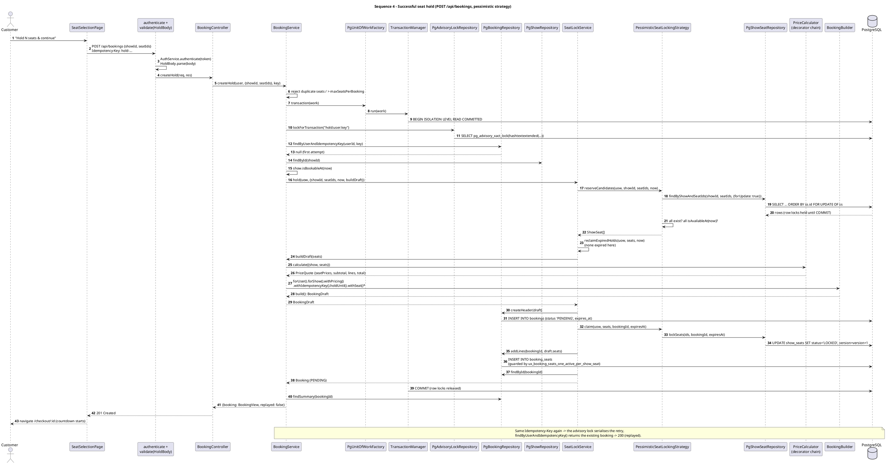

## C5. Sequence - Concurrent booking attempts

Two users race for one seat. With `FOR UPDATE` the loser blocks, then re-reads the committed LOCKED row and gets 409; the optimistic variant fails its version compare-and-set. The partial unique index is the final guard.

**Code:** `concurrency/SeatLockingStrategy.ts`, `db/migrations/001_initial_schema.sql`, `tests/concurrency/booking-concurrency.test.ts`

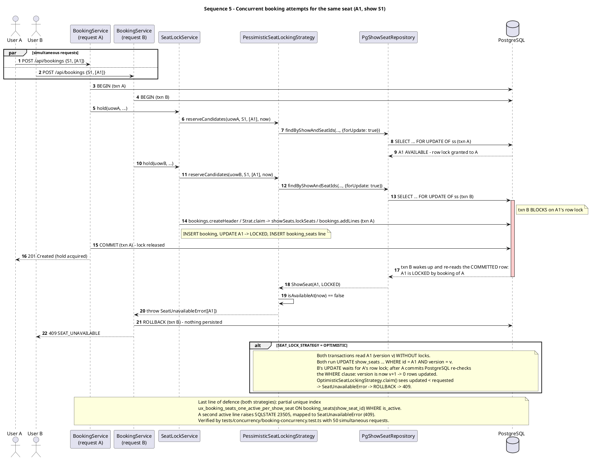

## C6. Sequence - Booking conflict in the UI

How the frontend reacts to a 409: keep the server message, `poller.refresh()`, prune the selection, re-render.

**Code:** `frontend/src/pages/SeatSelectionPage.tsx`, `api/httpClient.ts`

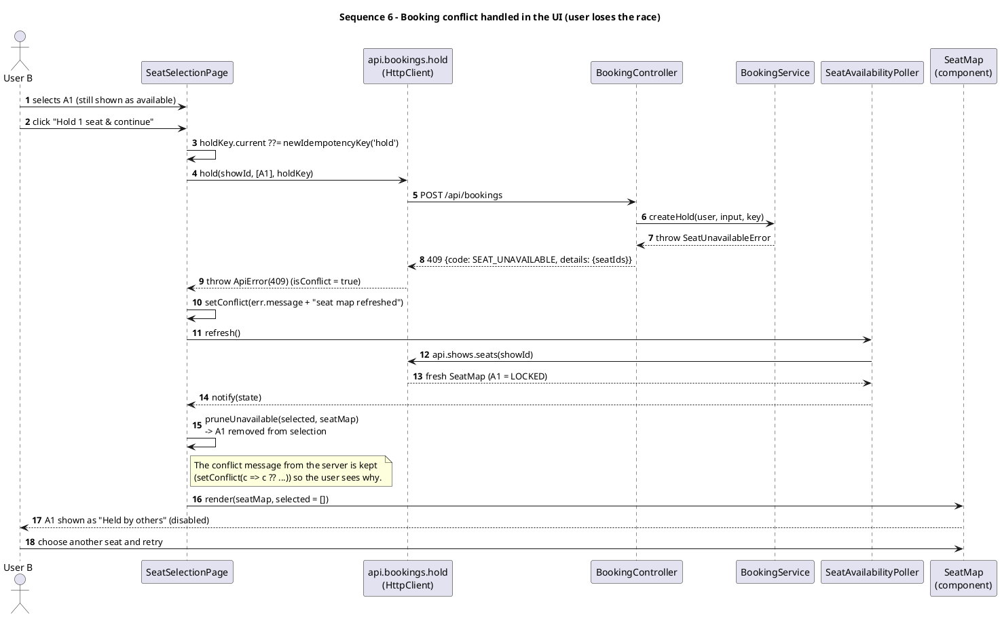

## C7. Sequence - Payment success

Lock order seats → booking, idempotent replay check, Strategy (`CardPaymentStrategy`) → Adapter (`LegacyPayGatewayAdapter`) → simulated SDK, seats BOOKED, booking CONFIRMED, COMMIT, then Observer notifications.

**Code:** `services/BookingService.ts#pay`, `payments/*`, `notifications/*`

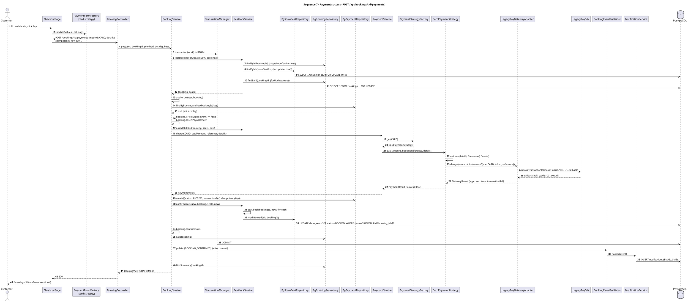

## C8. Sequence - Payment failure

A *decline* is a business outcome and is committed (payment FAILED, booking FAILED, seats released, 402). A *gateway outage* is an exception → ROLLBACK → hold intact, retry possible. An expired hold yields 410.

**Code:** `services/BookingService.ts#pay`, `payments/gateway/LegacyPaySdk.ts` (simulation rules), `tests/integration/bookings.test.ts`

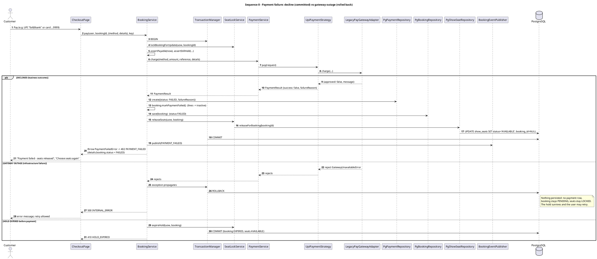

## C9. Sequence - Booking cancellation

Business rules live in `Booking.cancel`: pending holds release freely; confirmed bookings refund only ≥ cut-off minutes before the show; otherwise 422/409 and ROLLBACK.

**Code:** `domain/Booking.ts#cancel`, `services/BookingService.ts#cancel`, `frontend/src/pages/BookingPages.tsx`

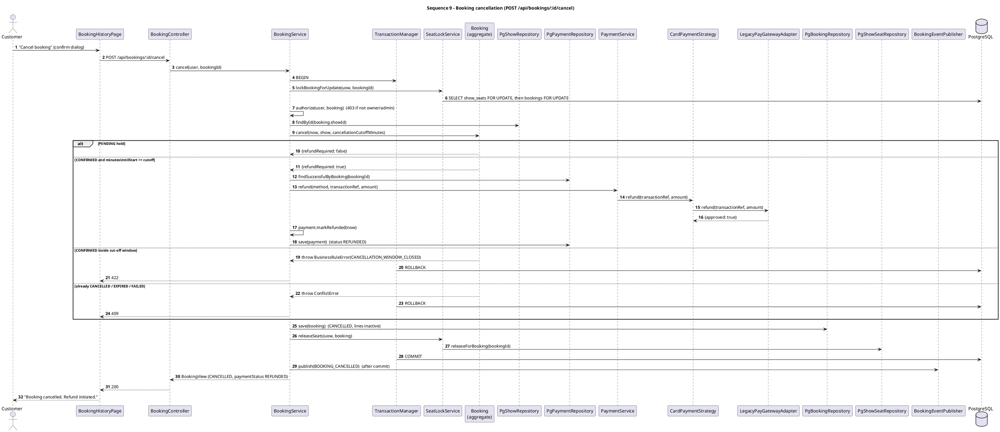

## D. Activity Diagram - Complete booking workflow

Selection → hold (validation, idempotency, locking, reclaim, conflict loop) → checkout countdown in parallel with the expiry sweeper → payment (expiry, invalid state, outage/rollback/retry, approve vs decline) → optional cancellation with refund.

**Code:** `services/BookingService.ts`, `services/SeatLockService.ts`, `services/HoldExpiryJob.ts`, `frontend/src/pages/*`

```plantuml
@startuml activity-booking
title Activity - Complete booking workflow
start
:Customer opens seat map (/shows/:id);
:SeatAvailabilityPoller polls GET /shows/:id/seats every 5 s;
repeat
  :Select seats (Manual or ContiguousBlock strategy);
  :Click "Hold seats";
  if (Logged in?) then (no)
    :Redirect to /login, then back;
  endif
  partition "POST /api/bookings (one DB transaction)" {
    :Validate request (zod HoldBody, duplicates, max seats);
    if (Idempotency-Key already used by this user?) then (yes)
      :Return existing booking (200 replayed);
      detach
    endif
    :Check show is SCHEDULED and not started;
    :Lock seat rows (SELECT ... FOR UPDATE)\nor read versions (optimistic);
    if (All seats exist?) then (no)
      :404 NOT_FOUND;
      stop
    endif
    if (Every seat AVAILABLE or lock expired?) then (no)
      :ROLLBACK;
      :409 SEAT_UNAVAILABLE;
    else (yes)
      :Re-claim expired locks\n(deactivate old lines, mark old booking EXPIRED);
      :Price seats (strategy + decorators);
      :Build BookingDraft (BookingBuilder);
      :INSERT booking (PENDING, expires_at = now + hold);
      :Seats -> LOCKED (claim);
      :INSERT booking_seats (unique active index);
      :COMMIT;
    endif
  }
  backward :UI refreshes seat map,\nprunes taken seats;
repeat while (Hold acquired?) is (no) not (yes)

:Checkout page shows price breakdown + countdown;
fork
  :Customer fills payment form;
fork again
  :HoldExpiryJob runs every 30 s;
  if (Hold expired and still PENDING?) then (yes)
    :Booking EXPIRED, seats AVAILABLE,\nBOOKING_EXPIRED notification;
  endif
end fork

if (Customer releases seats?) then (yes)
  :POST /bookings/:id/cancel -> CANCELLED, seats AVAILABLE;
  stop
endif

repeat
  partition "POST /api/bookings/:id/payments (one DB transaction)" {
    :Lock booking's seats FOR UPDATE, then booking FOR UPDATE;
    if (Same Idempotency-Key already paid?) then (yes)
      :Return original result;
      stop
    endif
    if (Hold expired?) then (yes)
      :Expire booking, release seats, COMMIT;
      :410 HOLD_EXPIRED -> choose seats again;
      stop
    endif
    if (Booking payable and seats still held?) then (no)
      :ROLLBACK;
      :409 already paid / invalid state;
      stop
    endif
    :PaymentService.charge() -> strategy -> adapter -> gateway;
  }
  if (Gateway reachable?) then (no)
    :Exception -> ROLLBACK\n(hold untouched, nothing persisted);
    :500 - user may retry;
  endif
repeat while (Retry after outage?) is (yes) not (no / answered)

if (Approved?) then (yes)
  :Payment SUCCESS;
  :Seats LOCKED -> BOOKED;
  :Booking PENDING -> CONFIRMED;
  :COMMIT;
  :Publish BOOKING_CONFIRMED\n(e-mail + SMS notification);
  :Show confirmation ticket;
  if (Customer cancels later?) then (yes)
    if (>= cut-off before show start?) then (yes)
      :Refund via payment strategy;
      :Payment REFUNDED, booking CANCELLED,\nseats AVAILABLE, COMMIT;
      :Publish BOOKING_CANCELLED;
    else (no)
      :422 CANCELLATION_WINDOW_CLOSED;
    endif
  endif
else (declined)
  :Payment FAILED;
  :Booking FAILED, seats released;
  :COMMIT;
  :Publish PAYMENT_FAILED;
  :402 PAYMENT_FAILED -> choose seats again;
endif
stop
@enduml
```

